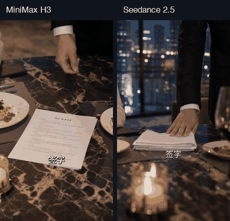
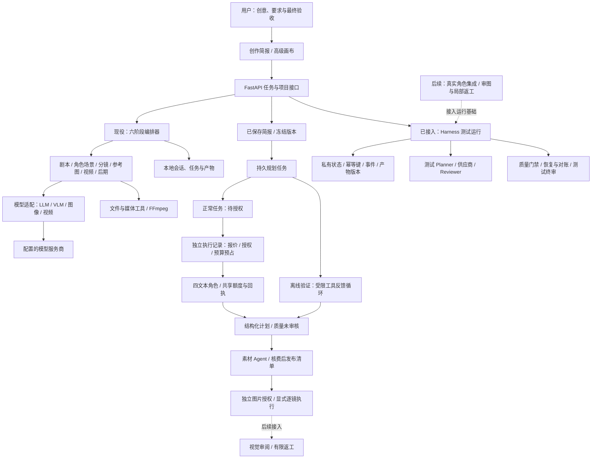
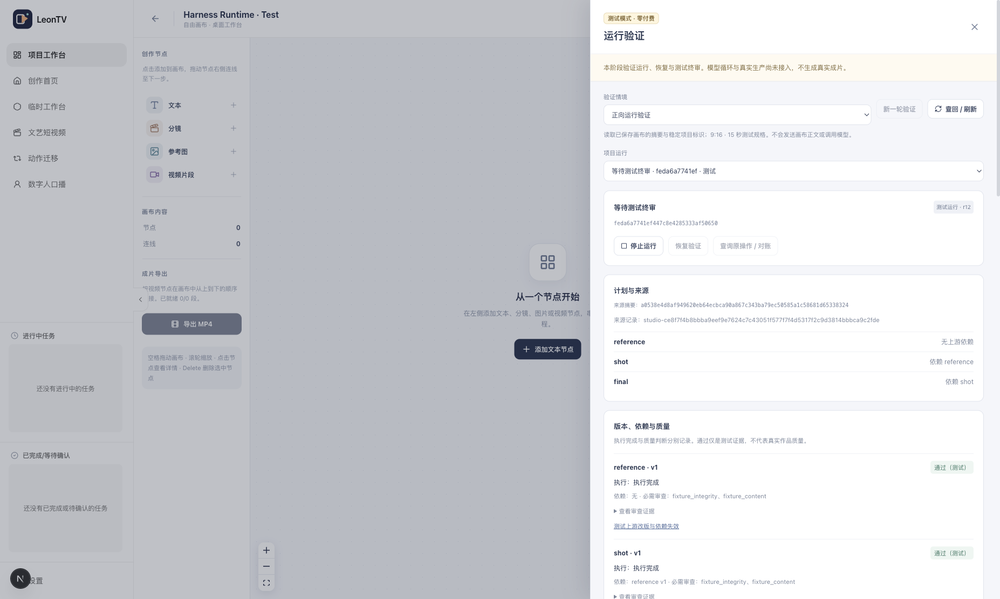

<div align="center">

# LeonTV

### 面向 AI 视频创作的 Agent Harness

从创意、剧本到分镜、画面与成片，让创作过程可观察、可修改、可继续。

**简体中文** · [English](./README_EN.md)

[视频演示](#视频演示) · [快速开始](#快速开始) · [架构](#agent-harness-架构) · [能力状态](#当前能力与边界) · [路线图](./docs/ROADMAP.md)


[](./LICENSE)

</div>

LeonTV 是一个本地运行的 AI 视频创作工作台，以 **Agent Harness** 为演进架构：将任务规划、模型与工具调用、上下文、执行状态、质量反馈和人工验收连接起来，让 Agent 能在明确的边界内持续完成创作任务。

当前版本提供六阶段创作工作流、自由画布、单次生成工具和专项视频流水线，并已完成真实图像与双模型视频试制。**首个 Harness 运行基础已接入 Studio、正式 API 与私有持久存储**，支持幂等创建、查回、版本与质量门禁、停止/恢复、原操作对账和测试终审。在此基础上，A「放映室」已加入简报版本冻结、持久规划任务与受限工具反馈循环；高级入口可用合成响应验证一次启动后的 **规划→独立首审→有限改稿→独立复核**，查看五项标准、v1到v2的字段变化及旧问题解决记录。四个文本角色已接入同一受控执行通道，共享报价授权、累计额度与回执；D26已从页面一次启动完成真实规划和独立首审，并逐次核费。D27已把执行范围配置和平台费用收件箱接入正式后端，支持原记录只读恢复、幂等核费和重启后显式续行。D31／D32已接入素材文本 Agent、经核费证明的图片交接和独立图片操作端，共用原执行记录及预算门禁。真实素材清单已完成并核费；图片执行、查询和交付均须使用显式授权。[图片操作端验收](./docs/IMAGE-OPERATOR-VALIDATION.md)。真实内容改稿／复核及媒体闭环仍待验收，生产默认关闭。[本轮真实结果](./docs/PLANNER-EMPIRICAL-EXECUTION-VALIDATION.md)。受控试制已执行真实规划、独立文字审阅、首帧生成与视觉局部返工；自主制作与媒体终验仍在建设中。详细边界见[架构说明](./docs/ARCHITECTURE.md)。

## 视频演示

以下是通过真实模型 API 生成的结果，采用同一场景、同一参考图与同一首次提示词。动态预览左侧为 MiniMax H3，右侧为 Seedance 2.5；完整文件保留原生音轨。

[](./docs/DEMO.md)

| MiniMax H3 · 15秒 | Seedance 2.5 · 15秒 |
| :---: | :---: |
| [播放完整视频](https://github.com/user-attachments/assets/f9f2dc33-182f-47ab-af82-89b0430438e8) | [播放完整视频](https://github.com/user-attachments/assets/3f925daf-0cf4-498a-b58d-2f83b11b5bb6) |
| [仓库MP4副本](./docs/assets/demos/minimax-h3-15s.mp4) | [仓库MP4副本](./docs/assets/demos/seedance-2.5-15s.mp4) |

两条审阅文件均为 **720 × 1280、9:16、24 fps、15 秒、H.264 + AAC**，生成后经过 FFmpeg 规格规范化，并通过完整文件解码检查。它们是技术验证样片，仍有模型自行生成字幕等内容缺陷；本轮由操作侧编排和审查，不代表产品自主 Harness 已验收通过。[查看演示说明与文件校验](./docs/DEMO.md)。

## 你可以用 Leon TV 做什么

| 工作方式 | 适合的任务 | 你能控制的内容 |
| --- | --- | --- |
| **创作简报 · 放映室** | 先保存剧本、制作要求和预算草稿，稍后继续编辑 | 私有保存、版本历史、刷新恢复和并发冲突核对；保存不授权、不启动生成 |
| **简报规划任务** | 锁定已保存版本，查看规划状态、反馈事件与镜头计划 | 正式任务待授权；独立离线入口验证工具循环、有限修正与中断恢复 |
| **六阶段创作** | 从故事或创意逐步制作短片、短剧片段 | 剧本、人物与场景、分镜、参考图、视频、后期的中间产物与确认 |
| **自由画布** | 用节点组织文字、图像、视频素材与创作关系 | 项目保存、节点连线、单节点生成、任务状态与结果预览 |
| **单次生成工具** | 单独试提示词、试模型或制作素材 | 文生图、图生图、视频生成参数和异步任务 |
| **专项流水线** | 快速短视频、动作迁移、数字人等流程探索 | 对应模型、输入素材与任务结果；可用性取决于实际服务商能力 |
| **Harness 运行验证** | 在项目内检查执行、门禁与恢复 | 测试计划、版本、事件、零付费额度、原操作对账与测试终审；不生成真实作品 |

创作工作流按以下顺序推进：

```text
创意 / 剧本
    ↓
剧本策划 → 角色与场景 → 分镜规划 → 参考图 → 视频片段 → 后期合成
    ↑          ↑           ↑          ↑          ↑
    └──────── 查看、确认、修改与按阶段继续 ────────────┘
```

- **分镜驱动**：将故事转换为结构化镜头，逐步确定画面与动作。
- **中间产物可见**：查看和修改角色、分镜、图像与视频结果。
- **模型可替换**：LLM、视觉评估、图像和视频由独立客户端适配，不同环节可使用不同服务商。
- **局部质量反馈**：部分角色、参考图和分镜阶段已有评估、校验及有限次修正逻辑。
- **本地项目留存**：会话、画布、任务状态与生成媒体保存在本机。

## Agent Harness 架构

Harness 是支撑 Agent 持续工作的运行基础：它管理工具权限、上下文、状态、预算、检查点、质量反馈和异常恢复。Leon TV 的目标是让创作 Agent 接到制作需求后，能完成规划、调用生成工具、检查结果、局部返工，最后将成片交给人验收。



**现役创作执行层**是固定六阶段状态机，已有阶段反馈与人工确认点。**Harness 运行基础**已进入正式产品路径；测试只替代 Planner、Reviewer 和供应商，界面、API、存储和恢复使用真实实现。测试素材通过不代表真实画面质量合格；完整自主创作能力还需要接入真实模型并验收。

具体类、接口与实验边界见 [ARCHITECTURE.md](./docs/ARCHITECTURE.md)。

## 当前能力与边界

| 能力 | 状态 | 当前含义 |
| --- | --- | --- |
| 创作简报与预算草稿 | 已实现 | A「放映室」正式入口，真实私有持久化与版本恢复；尚未连接自主制作 |
| 六阶段工作流、项目与画布 | 已实现 | 可在本机运行；真实生成需配置相应模型服务商 |
| 阶段内评估与有限修正 | 部分实现 | 角色、参考图、分镜等阶段具有局部逻辑 |
| 真实图像与视频生成 | 历史试制已交付 | 两条历史视频见上方；D21本轮通道失败、无新视频，不等于所有模型和参数均通过验收 |
| 产品内持久运行、版本门禁与恢复 | 测试模式已接入 | Studio「运行验证」、正式 API 与真实存储；使用测试素材，模型与付费调用均为零 |
| 规划授权与费用门禁 | 已接入，经验风险模式完成真实试跑 | 报价授权、累计风险、可靠回执和逐次平台核费；风险、估价与平台观察分列 |
| Chat / Responses 文本协议 | 服务端显式适配 | 固定协议、模型及Chat输出参数，不自动切换；真实Gemini探针已核费，当前通道仍未建立输出计费硬界 |
| 独立回执采集与只读检查 | 合成故障验收通过 | 显式开启后先持久保存再通知；观察进程退出后有界采集，迟到证据隔离；检查不重发或结算，默认关闭 |
| 经验风险试跑接入 | 真实规划→首审已验证 | 一次启动完成真实4镜v1；4次调用平台观察¥0.038086，默认关闭 |
| 服务端范围与费用恢复 | 已接入正式后端 | 显式配置、单任务准入、原始平台导出核费及崩溃恢复；操作员UI和自动日志拉取待接入 |
| 素材交接准备 | 已接入正式只读 API | 新合同支持1–12镜，保留来源／分镜／接受报告与预算历史；不扩旧文本授权 |
| 受控图片工具组件 | 默认关闭，合成调用验收 | 独立媒体许可、POST／GET原始回执、文件技术检查与直接请求ID费用候选；由统一媒体账本核验真实授权 |
| 统一媒体执行账本 | 已接原journal，默认关闭 | 独立报价／授权、保留风险、原task查询、文本／素材／图片费用全局认领和交付身份；未开放通用生产 |
| 原生素材文本 Agent | 真实单次调用已核费 | 接受分镜后生成角色、场景和四镜清单；实际回执与唯一费用证明通过后才可交给图片工具 |
| 图片核费只读诊断 | 已接入操作端 | 分列受理、POST身份、候选费用、交付与质量；读取不认领费用、不续开权限 |
| 显式图片操作端 | 已交付1张，首镜任务quota已认领 | 独立范围授权、原任务查询和本地交付；第二镜unknown，后两镜未预留；原策略已到期，默认关闭 |
| 图片续接预审 | D36真实历史只读核验通过 | 保留原unknown与消耗，派生新窗口／替代版本／增量额度；当轮未激活或生成 |
| 图片续接授权 | D37授权已落账，原记录保留 | 原journal保存方案／预留意图／激活及唯一父预留；D37的`dispatch_ready=false`保持，历史结果见独立验收 |
| 图片运行时续接 | D39单次真实POST已受理并核费，派发性能／交付未验收 | 同一intent与已留4+1额度，精确代码／新lease、v2 permit和候选门禁；不重置次数、不重发原unknown |
| 内部参考图转换 | 显式选用 | WEBP等原交付转无损PNG；JPEG压缩须报价披露，保留原图和转换证明；技术校验不代表视觉通过 |
| 素材角色与首帧 | 三镜最终组合通过独立视觉检查 | 全局定型、逐镜引用、局部图片版本及全组合复核；成片与人工终验待进行 |
| 真实生产质量审查与修复 | 图片受控闭环已执行 | 独立查看者发现问题、指定镜头修订与复核；产品运行时视觉模型集成待完成 |
| 简报冻结与受限 Planner 循环 | 离线闭环已接入 | 真实任务/工具/存储/恢复，合成模型响应；计划结构合格仍为质量未审核 |
| Planner → 独立审阅 → 有限改稿与复核 | 真实规划首审通过，内容改稿复核仍待实测 | 四角色共用授权、累计额度与回执；合成拒绝→v2→复核通过，真实首审接受后跳过改稿 |
| 真实角色与自动局部返工的产品闭环 | 正式运行集成待完成 | 受控实测已走通首帧审图与局部返工；视频生产及成片终验待完成 |
| Agent to Agent、长期个人记忆、Personal Agent | 后续方向 | 尚未实现为可用产品能力 |

[D26 真实产品执行](./docs/PLANNER-EMPIRICAL-EXECUTION-VALIDATION.md)已从放映室一次启动，生成4镜、15秒、9:16的v1，独立Reviewer五项规则均接受。Planner自动修正一次无效动作格式，4次调用逐笔核费共¥0.038086。内容Repairer／Rechecker未触发，媒体和人工终验待完成。早期[规划](./docs/PLANNER-READ-CONTEXT-VALIDATION.md)与[首审](./docs/PLANNER-REVIEW-VALIDATION.md)受控试制作为历史记录保留。

[D28素材交接](./docs/PRODUCT-ASSET-HANDOFF-VALIDATION.md)已用真实四镜接受记录核验；新清单与原三镜媒体分别绑定版本，尚未发起本次四镜图片制作。[D29图片工具组件](./docs/CONTROLLED-IMAGE-TOOLS-VALIDATION.md)进一步接通共享回执采集中的提交／查询、文件技术核验与费用候选，自动调度仍待接入。

[D30媒体账本](./docs/MEDIA-EXECUTION-VALIDATION.md)把图片工具接入同一执行journal的报价、授权、生成意图、费用观察／全局认领与恢复。继承父范围完整冻结预算；未知请求与超额不会通过换grant重试。当前为服务端能力及只读状态接口，尚未启用新的真实四镜制作或视觉Agent。

[D31素材执行](./docs/ASSET-DESIGN-VALIDATION.md)与[D32图片操作端](./docs/IMAGE-OPERATOR-VALIDATION.md)将素材文本、图片的独立授权、实际回执、费用与交付接入同一记录。素材清单已真实生成并核费；图片引用转换须预先披露，未知、待核费或超额会停止同账户后续收费请求。D32首镜已交付，当时因缺直接POST请求ID而待核费，其余三镜暂停；后续进展见D34。自动视觉审阅、视频生产和人工终验仍待接入。

[D34任务核费与代码续接](./docs/TASK-FEE-CONTINUATION-VALIDATION.md)已接入原账本：首镜¥0.04任务quota观察完成认领，task/request身份统一去重；原范围的代码升级经明确披露续接，预算、次数和有效期保持原约束。完整后端2451项/73子测试通过。第二镜真实续行停为unknown，没有新增可交付图片；只读基准强烈指向重复历史校验耗尽时限，确切异常阶段仍缺证。完整图集、视觉审阅和人工终验仍待完成。费用观察不等于最终账单确认。

[D35历史校验与故障阶段](./docs/RUNTIME-VALIDATION-PERF-VALIDATION.md)减少了重复开销：同一真实记录的完整请求重建665→4次，逐帧媒体验证保留，历史读取样本约6.9→3.9秒；每次权限判断仍读取新鲜状态。新采集失败可记录固定阶段，原第二镜保持unknown和历史证据缺失。完整2501项/73子测试通过；当轮没有新增真实生成。后续续接预审与授权合同见D36、D37，有效许可内的完整派发仍待验收。

[D36图片续接预审](./docs/IMAGE-CONTINUATION-PREFLIGHT-VALIDATION.md)已将过期范围、原未知请求和剩余镜头绑定成可独立复核的方案。原范围剩余2次、待交付3镜，因此提出在100元原预算内增加1次／1元保留风险；D36当轮未分配或扣费。原未知、费用及交付保留，真实历史只读导出／复核／重放通过。

[D37图片续接授权](./docs/IMAGE-VALIDITY-CONTINUATION-API.md)将方案、持久预留意图和激活记录接入原journal：意图成立即保留新增1元／1次，父写入只接受原45条加同一方案的唯一分配，中断恢复与重放不重复占额。合同中的账户包络从81.37元／53次增至82.37元／54次，属于本地保守风险预留，不是消费或平台资金冻结。激活固定为`dispatch_ready=false`、`runtime_contract_pending=true`，旧unknown、范围、grant和policy均保留。[实际写入与检查结果](./docs/IMAGE-VALIDITY-CONTINUATION-VALIDATION.md)单独记录。D37当轮未接通生成执行；后续版本合同见D38，原记录及其检查结论保持为历史。

[D38运行时续接合同](./docs/IMAGE-RUNTIME-CONTINUATION-API.md)已把精确代码／新lease批准、v2图片permit和剩余目标接入原执行器。同一intent和已留4+1分配继续使用，新增风险／调用均为0；原scope、grant、unknown与消耗不变。运行时预留、派发／采集、媒体账本和共享预算统一检查精确候选，文字／素材及其他范围不能借用旧unknown例外；引用绑定明确的operation／query／delivery版本。新unknown、待核费或超额阻止新付费POST，明确accepted task的显式有界GET仍按当前版本授权判断，没有自动查询或重试。D38当轮只批准版本，没有新图片请求；[该轮历史验收](./docs/IMAGE-RUNTIME-CONTINUATION-VALIDATION.md)单独记录。

[D39真实派发与核费](./docs/IMAGE-DISPATCH-ACCEPTANCE-VALIDATION.md)已在同一任务取得第二镜新attempt的HTTP 200，平台任务SUCCESS，¥0.04观察费用已原生认领。permit签发到collector为106.79秒，但reserve入口到collector为121.64秒，未达到入口口径的性能目标；新历史体积也使后续GET接近原120秒期限。因此尚未查询下载或交付新图片。下一步减少重复校验，并实现绑定原受理任务的显式仅GET续查合同，再继续后两镜与视觉／媒体终验；保留原100元预算、风险、消耗及旧unknown。

[素材角色](./docs/ASSET-HANDOFF-VALIDATION.md)已生成真实首帧；[D20 视觉审阅与局部返工](./docs/ASSET-VISUAL-REVIEW-VALIDATION.md)进一步修复道具、机位和特写，最终三镜组合通过独立检查。三次修订平台费用共 ¥0.12，1174 项全量测试及 5 个子测试通过。视觉查看由独立 Codex Agent 完成，尚未集成为产品运行时 VLM。

[D21 视频实测](./docs/VIDEO-GENERATION-VALIDATION.md)已用同一份已验收首帧和分镜，向 MiniMax H3、Seedance 2.5 各提交一次 15 秒生成请求。两次均因供应商上游通道不可用而失败，没有新视频；对应错误日志费用观察为 ¥0，风险预留继续保留。本轮已停止重试，待原通道恢复或确定替代渠道后继续。视频简报合同已实现；正式视频调度、VLM、自动核费、人工终验及[完整自主协作](./docs/AUTONOMOUS-COLLABORATION-GOAL.md)仍待完成。

## 快速开始

### 环境

- Python **3.10+**，推荐 3.12；后端建议使用 [uv](https://docs.astral.sh/uv/)。
- Node.js **20.9+** 与 npm。
- FFmpeg 用于媒体合成；后端优先使用系统安装，也支持 `imageio-ffmpeg` 提供的可执行文件。
- 真实生成需要模型服务商密钥，费用由对应服务商收取。没有密钥时可以查看界面、创建项目和组织画布。

### 安装

```bash
git clone https://github.com/leo-ai-pm/LeonTV.git
cd LeonTV
cd "Leon TV/Leon TV"
./install.sh
```

安装器会安装前后端依赖、构建前端，并在本地配置不存在时复制空密钥模板。Windows 可运行同目录的 `install.bat`。需要手动安装、跳过构建或修改端口时，见[安装指南](./docs/GETTING_STARTED.md)。

### 启动

下面两个终端均从**仓库根目录**开始：

```bash
# 终端一：后端
cd "Leon TV/Leon TV/backend"
uv run python api_server.py
```

```bash
# 终端二：前端
cd "Leon TV/Leon TV/frontend"
npm run dev
```

打开 **http://localhost:3000**。后端健康检查为 **http://127.0.0.1:8000/api/health**。

默认进入 A「放映室」创作简报，可保存、重新打开和编辑剧本、要求及预算草稿，无需模型密钥。保存不会调用模型或构成付费授权。原有画布、六阶段与测试运行从「高级创作」进入。[简报接口](./docs/CREATOR-BRIEF-API.md) · [简报验证](./docs/CREATOR-BRIEF-VALIDATION.md)。

保存后可在下方「准备规划任务」锁定该版本；未保存编辑或冲突会阻止创建。正式任务保持待授权，不调用模型。「高级 · 离线控制流验证」可创建测试任务，再明确启动，观察坏计划反馈与有限修正。测试计划仅证明控制流和结构校验，不代表 AI 真实创作或内容质量通过。[规划接口](./docs/BRIEF-PLANNER-API.md) · [规划验证](./docs/BRIEF-PLANNER-VALIDATION.md)。

规划详情中的授权与费用面板分别处理服务端报价、范围授权和开始执行。每次请求先记录风险与调用意图；暂停或换授权不重置累计消耗。真实模型调用默认关闭；D26已在显式启用范围内完成真实文本规划与独立首审，核费后才处理输出并交接。平台费用观察不是最终供应商账单，媒体和人工验收另行进行。[执行控制](./docs/PLANNER-EXECUTION-API.md) · [经验风险接入](./docs/PLANNER-EMPIRICAL-EXECUTION-API.md) · [服务端配置与费用恢复](./docs/EXECUTION-CONTROL-API.md)。

服务端策略可明确选择 Chat Completions 或 Responses。Responses 请求关闭流式、远端续链与内置工具；缓存和推理 token 作为总用量的子集处理，未知计费维度保留预占。新增协议不自动启用模型，也不改写旧规划记录的授权与摘要。[Responses 协议](./docs/PLANNER-RESPONSES-API.md) · [验证与真实试跑边界](./docs/PLANNER-RESPONSES-VALIDATION.md)。

### 配置模型

在「设置」中配置所需服务商密钥和各阶段模型，或编辑本地 `Leon TV/Leon TV/backend/config.yaml`。模板为 [`config.yaml.example`](./Leon%20TV/Leon%20TV/backend/config.yaml.example)，真实配置不会提交到仓库。

| 服务商适配 | 配置位置 | 用途 |
| --- | --- | --- |
| OpenAI / Gemini / DeepSeek | `api_providers.openai / gemini / deepseek` | 文本与视觉能力，取决于具体模型 |
| DashScope | `api_providers.dashscope` | 通义文本、视觉、图像及视频 |
| 火山方舟 | `api_providers.ark` | Seedream、Seedance 等适配 |
| 可灵 | `api_providers.kling` | 可灵视频适配 |
| 土豆 API | `api_providers.tudou` | 本轮 `minimax-h3`、`seedance-2.5` 等渠道模型 |

请为所选模型配置对应服务商。不同模型支持的时长、分辨率、参考图方式和音频参数可能不同；目录中的型号不代表所有组合已实测。模型目录见 [`models/config_model.py`](./Leon%20TV/Leon%20TV/backend/models/config_model.py)。

### 零付费运行验证

在「项目工作台」新建或打开画布项目，点击右上角 **运行验证 · 测试**。选择情境后创建测试运行，可查看计划、来源摘要、版本依赖、质量判断、调用计数、测试素材和持久事件。刷新后打开同一项目即可查回原运行。

界面提供正常完成、局部返工、质量未知/未通过、结果待对账、额度耗尽及恢复检查点等情境。结果未知时须先查原操作；上游改版使后代与旧审查失效。测试终审绑定当前版本与哈希。

此入口不需要模型密钥，付费限额为零，媒体明确标注 TEST。它验证产品运行机制，不能制作真实小说短片，也不代表用户已接受成片。[API 合同](./docs/HARNESS-RUNTIME-API.md) · [验证范围](./docs/HARNESS-RUNTIME-VALIDATION.md)。



## 项目结构

```text
LeonTV/
├── README.md / README_EN.md
├── docs/                          # 公共架构、安装、路线图与演示
│   └── assets/demos/               # 两条真实视频、封面与动态预览
├── Leon TV/
│   ├── SKILL.md / references/      # 外部 Agent 调用说明
│   └── Leon TV/
│       ├── backend/
│       │   ├── api/                # FastAPI、路由、schema、项目存储
│       │   ├── core/               # 六阶段 Agent 与 Harness 运行基础
│       │   ├── models/             # 模型目录与服务商适配
│       │   ├── pipelines/          # 专项视频流程
│       │   ├── prompts/            # 各阶段提示词
│       │   ├── experiments/        # Harness PoC 与受控试制代码
│       │   └── tests/
│       ├── frontend/              # Next.js、React Flow、创作界面
│       └── install.sh / install.bat
└── tests/                         # 安装器检查
```

本地任务与媒体写入 `backend/code/data/` 和 `backend/code/result/`；Harness 产品运行与实验私有状态写入 `backend/harness_data/`，产品运行素材仅经受控 ID 接口读取。这些目录、密钥和私人制作资料均不随源码发布。

## 开发与路线图

开发环境与检查命令见 [CONTRIBUTING.md](./CONTRIBUTING.md)。目前优先推进：

1. 在已接入的测试运行基础上增加真实模型和受限工具反馈。
2. 完成独立 Reviewer、有限次局部返工与真实生产预算保护。
3. 用真实创作任务验证内容质量、异常恢复与最终人工验收。
4. 在稳定创作闭环之上探索 Agent 协作、长期记忆与 Personal Agent。

完整分期与验收方向见[路线图](./docs/ROADMAP.md)。

## 常见问题

**所有东西都在本地生成吗？** 项目与媒体保存在本机；使用远程模型时，提示词与所需素材会发给所配置的服务商。模型数据政策与费用以服务商为准。

**画布会自动执行整张工作流吗？** 当前按节点手动运行并追踪异步任务，完整 DAG 自动规划与执行尚未实现。

**能直接部署成公共 SaaS 吗？** 当前面向个人本地使用；多用户鉴权、租户隔离、凭据托管与生产运维仍需另外实现。请保持默认本地监听。

**视频为什么可能不完全遵循要求？** 生成完成与内容合格是两件事。当前样片已暴露字幕和动作偏差，后续通过质量审查、反馈与有界返工逐步解决。

## 许可证

LeonTV 由本项目维护者持续开发和维护，产品展示与公开入口使用 LeonTV 品牌。

本仓库按 [MIT License](./LICENSE) 发布。使用的第三方代码及其必要版权与许可声明以许可证文件为准；产品命名调整不改变这些代码的权利归属。
