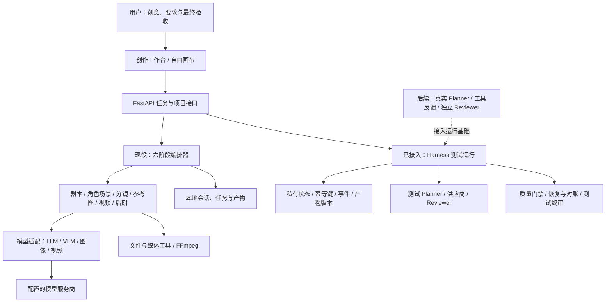
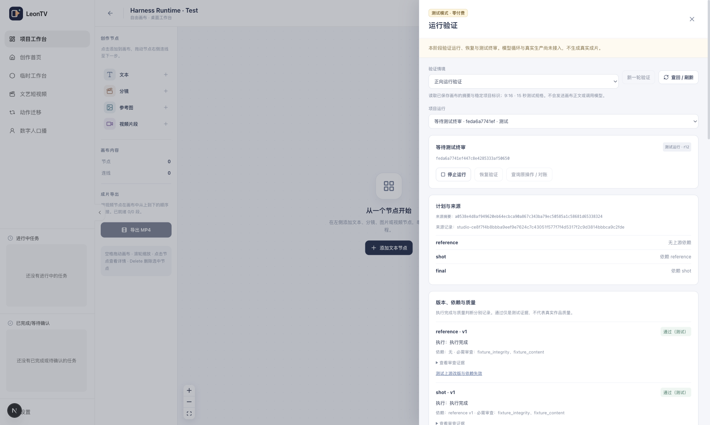

<div align="center">

# LeonTV

### 面向 AI 视频创作的 Agent Harness

从创意、剧本到分镜、画面与成片，让创作过程可观察、可修改、可继续。

**简体中文** · [English](./README_EN.md)

[视频演示](#视频演示) · [快速开始](#快速开始) · [架构](#agent-harness-架构) · [能力状态](#当前能力与边界) · [路线图](./docs/ROADMAP.md)


[](./LICENSE)

</div>

LeonTV 是一个本地运行的 AI 视频创作工作台，以 **Agent Harness** 为演进架构：将任务规划、模型与工具调用、上下文、执行状态、质量反馈和人工验收连接起来，让 Agent 能在明确的边界内持续完成创作任务。

当前版本提供六阶段创作工作流、自由画布、单次生成工具和专项视频流水线，并已完成真实图像与双模型视频试制。**首个 Harness 运行基础已接入 Studio、正式 API 与私有持久存储**，支持幂等创建、查回、版本与质量门禁、停止/恢复、原操作对账和测试终审。本切片只使用零付费测试素材；真实模型规划、独立 Reviewer 和自动创作返工闭环仍在建设中。详细边界见[架构说明](./docs/ARCHITECTURE.md)。

## 视频演示

以下是通过真实模型 API 生成的结果，采用同一场景、同一参考图与同一首次提示词。动态预览左侧为 MiniMax H3，右侧为 Seedance 2.5；完整文件保留原生音轨。

[](./docs/DEMO.md)

| MiniMax H3 · 15秒 | Seedance 2.5 · 15秒 |
| :---: | :---: |
| [播放完整视频](https://github.com/user-attachments/assets/f9f2dc33-182f-47ab-af82-89b0430438e8) | [播放完整视频](https://github.com/user-attachments/assets/3f925daf-0cf4-498a-b58d-2f83b11b5bb6) |
| [仓库MP4副本](./docs/assets/demos/minimax-h3-15s.mp4) | [仓库MP4副本](./docs/assets/demos/seedance-2.5-15s.mp4) |

两条审阅文件均为 **720 × 1280、9:16、24 fps、15 秒、H.264 + AAC**，生成后经过 FFmpeg 规格规范化，并通过完整文件解码检查。它们是技术验证样片，仍有模型自行生成字幕等内容缺陷；本轮由操作侧编排和审查，不代表产品自主 Harness 已验收通过。[查看演示说明与文件校验](./docs/DEMO.md)。

## 你可以用 Leon TV 做什么

| 工作方式 | 适合的任务 | 你能控制的内容 |
| --- | --- | --- |
| **六阶段创作** | 从故事或创意逐步制作短片、短剧片段 | 剧本、人物与场景、分镜、参考图、视频、后期的中间产物与确认 |
| **自由画布** | 用节点组织文字、图像、视频素材与创作关系 | 项目保存、节点连线、单节点生成、任务状态与结果预览 |
| **单次生成工具** | 单独试提示词、试模型或制作素材 | 文生图、图生图、视频生成参数和异步任务 |
| **专项流水线** | 快速短视频、动作迁移、数字人等流程探索 | 对应模型、输入素材与任务结果；可用性取决于实际服务商能力 |
| **Harness 运行验证** | 在项目内检查执行、门禁与恢复 | 测试计划、版本、事件、零付费额度、原操作对账与测试终审；不生成真实作品 |

创作工作流按以下顺序推进：

```text
创意 / 剧本
    ↓
剧本策划 → 角色与场景 → 分镜规划 → 参考图 → 视频片段 → 后期合成
    ↑          ↑           ↑          ↑          ↑
    └──────── 查看、确认、修改与按阶段继续 ────────────┘
```

- **分镜驱动**：将故事转换为结构化镜头，逐步确定画面与动作。
- **中间产物可见**：查看和修改角色、分镜、图像与视频结果。
- **模型可替换**：LLM、视觉评估、图像和视频由独立客户端适配，不同环节可使用不同服务商。
- **局部质量反馈**：部分角色、参考图和分镜阶段已有评估、校验及有限次修正逻辑。
- **本地项目留存**：会话、画布、任务状态与生成媒体保存在本机。

## Agent Harness 架构

Harness 是支撑 Agent 持续工作的运行基础：它管理工具权限、上下文、状态、预算、检查点、质量反馈和异常恢复。Leon TV 的目标是让创作 Agent 接到制作需求后，能完成规划、调用生成工具、检查结果、局部返工，最后将成片交给人验收。



**现役创作执行层**是固定六阶段状态机，已有阶段反馈与人工确认点。**Harness 运行基础**已进入正式产品路径；测试只替代 Planner、Reviewer 和供应商，界面、API、存储和恢复使用真实实现。测试素材通过不代表真实画面质量合格；完整自主创作能力还需要接入真实模型并验收。

具体类、接口与实验边界见 [ARCHITECTURE.md](./docs/ARCHITECTURE.md)。

## 当前能力与边界

| 能力 | 状态 | 当前含义 |
| --- | --- | --- |
| 六阶段工作流、项目与画布 | 已实现 | 可在本机运行；真实生成需配置相应模型服务商 |
| 阶段内评估与有限修正 | 部分实现 | 角色、参考图、分镜等阶段具有局部逻辑 |
| 真实图像与视频生成 | 已完成本次试制 | 两条实际结果见上方；不等于所有模型和参数均通过验收 |
| 产品内持久运行、版本门禁与恢复 | 测试模式已接入 | Studio「运行验证」、正式 API 与真实存储；使用测试素材，模型与付费调用均为零 |
| 真实生产预算、质量审查与修复 | 待接入运行基础 | 既有适配与试制代码尚未组成完整产品闭环 |
| 自主 Planner、独立 Reviewer、自动局部返工 | 规划中 | 需要真实任务闭环与恢复验证 |
| Agent to Agent、长期个人记忆、Personal Agent | 后续方向 | 尚未实现为可用产品能力 |

## 快速开始

### 环境

- Python **3.10+**，推荐 3.12；后端建议使用 [uv](https://docs.astral.sh/uv/)。
- Node.js **20.9+** 与 npm。
- FFmpeg 用于媒体合成；后端优先使用系统安装，也支持 `imageio-ffmpeg` 提供的可执行文件。
- 真实生成需要模型服务商密钥，费用由对应服务商收取。没有密钥时可以查看界面、创建项目和组织画布。

### 安装

```bash
git clone https://github.com/leo-ai-pm/LeonTV.git
cd LeonTV
cd "Leon TV/Leon TV"
./install.sh
```

安装器会安装前后端依赖、构建前端，并在本地配置不存在时复制空密钥模板。Windows 可运行同目录的 `install.bat`。需要手动安装、跳过构建或修改端口时，见[安装指南](./docs/GETTING_STARTED.md)。

### 启动

下面两个终端均从**仓库根目录**开始：

```bash
# 终端一：后端
cd "Leon TV/Leon TV/backend"
uv run python api_server.py
```

```bash
# 终端二：前端
cd "Leon TV/Leon TV/frontend"
npm run dev
```

打开 **http://localhost:3000**。后端健康检查为 **http://127.0.0.1:8000/api/health**。

### 配置模型

在「设置」中配置所需服务商密钥和各阶段模型，或编辑本地 `Leon TV/Leon TV/backend/config.yaml`。模板为 [`config.yaml.example`](./Leon%20TV/Leon%20TV/backend/config.yaml.example)，真实配置不会提交到仓库。

| 服务商适配 | 配置位置 | 用途 |
| --- | --- | --- |
| OpenAI / Gemini / DeepSeek | `api_providers.openai / gemini / deepseek` | 文本与视觉能力，取决于具体模型 |
| DashScope | `api_providers.dashscope` | 通义文本、视觉、图像及视频 |
| 火山方舟 | `api_providers.ark` | Seedream、Seedance 等适配 |
| 可灵 | `api_providers.kling` | 可灵视频适配 |
| 土豆 API | `api_providers.tudou` | 本轮 `minimax-h3`、`seedance-2.5` 等渠道模型 |

请为所选模型配置对应服务商。不同模型支持的时长、分辨率、参考图方式和音频参数可能不同；目录中的型号不代表所有组合已实测。模型目录见 [`models/config_model.py`](./Leon%20TV/Leon%20TV/backend/models/config_model.py)。

### 零付费运行验证

在「项目工作台」新建或打开画布项目，点击右上角 **运行验证 · 测试**。选择情境后创建测试运行，可查看计划、来源摘要、版本依赖、质量判断、调用计数、测试素材和持久事件。刷新后打开同一项目即可查回原运行。

界面提供正常完成、局部返工、质量未知/未通过、结果待对账、额度耗尽及恢复检查点等情境。结果未知时须先查原操作；上游改版使后代与旧审查失效。测试终审绑定当前版本与哈希。

此入口不需要模型密钥，付费限额为零，媒体明确标注 TEST。它验证产品运行机制，不能制作真实小说短片，也不代表用户已接受成片。[API 合同](./docs/HARNESS-RUNTIME-API.md) · [验证范围](./docs/HARNESS-RUNTIME-VALIDATION.md)。



## 项目结构

```text
LeonTV/
├── README.md / README_EN.md
├── docs/                          # 公共架构、安装、路线图与演示
│   └── assets/demos/               # 两条真实视频、封面与动态预览
├── Leon TV/
│   ├── SKILL.md / references/      # 外部 Agent 调用说明
│   └── Leon TV/
│       ├── backend/
│       │   ├── api/                # FastAPI、路由、schema、项目存储
│       │   ├── core/               # 六阶段 Agent 与 Harness 运行基础
│       │   ├── models/             # 模型目录与服务商适配
│       │   ├── pipelines/          # 专项视频流程
│       │   ├── prompts/            # 各阶段提示词
│       │   ├── experiments/        # Harness PoC 与受控试制代码
│       │   └── tests/
│       ├── frontend/              # Next.js、React Flow、创作界面
│       └── install.sh / install.bat
└── tests/                         # 安装器检查
```

本地任务与媒体写入 `backend/code/data/` 和 `backend/code/result/`；Harness 产品运行与实验私有状态写入 `backend/harness_data/`，产品运行素材仅经受控 ID 接口读取。这些目录、密钥和私人制作资料均不随源码发布。

## 开发与路线图

开发环境与检查命令见 [CONTRIBUTING.md](./CONTRIBUTING.md)。目前优先推进：

1. 在已接入的测试运行基础上增加真实模型和受限工具反馈。
2. 完成独立 Reviewer、有限次局部返工与真实生产预算保护。
3. 用真实创作任务验证内容质量、异常恢复与最终人工验收。
4. 在稳定创作闭环之上探索 Agent 协作、长期记忆与 Personal Agent。

完整分期与验收方向见[路线图](./docs/ROADMAP.md)。

## 常见问题

**所有东西都在本地生成吗？** 项目与媒体保存在本机；使用远程模型时，提示词与所需素材会发给所配置的服务商。模型数据政策与费用以服务商为准。

**画布会自动执行整张工作流吗？** 当前按节点手动运行并追踪异步任务，完整 DAG 自动规划与执行尚未实现。

**能直接部署成公共 SaaS 吗？** 当前面向个人本地使用；多用户鉴权、租户隔离、凭据托管与生产运维仍需另外实现。请保持默认本地监听。

**视频为什么可能不完全遵循要求？** 生成完成与内容合格是两件事。当前样片已暴露字幕和动作偏差，后续通过质量审查、反馈与有界返工逐步解决。

## 许可证

LeonTV 由本项目维护者持续开发和维护，产品展示与公开入口使用 LeonTV 品牌。

本仓库按 [MIT License](./LICENSE) 发布。使用的第三方代码及其必要版权与许可声明以许可证文件为准；产品命名调整不改变这些代码的权利归属。
