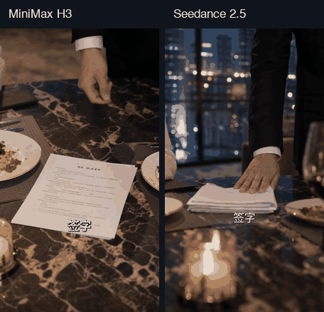
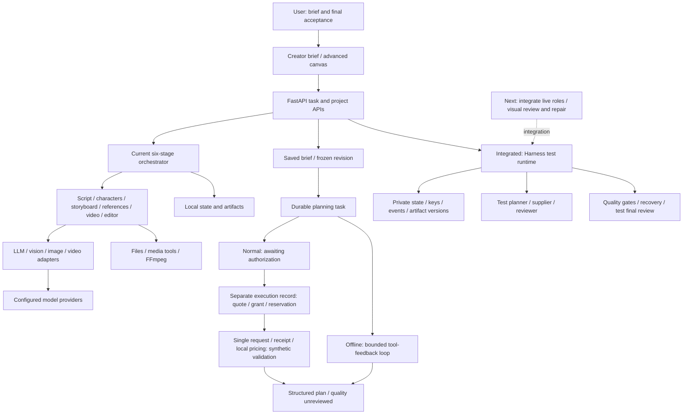
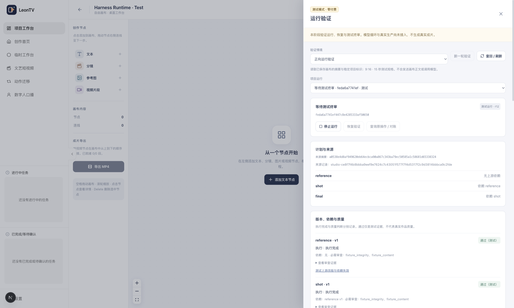

<div align="center">

# LeonTV

### An Agent Harness project for AI video creation

Turn ideas and scripts into storyboards, images, video clips and edited output—with visible, editable intermediate results.

[简体中文](./README.md) · **English**

[Video demos](#video-demos) · [Quick start](#quick-start) · [Architecture](#agent-harness-architecture) · [Status](#current-status) · [Roadmap](./docs/ROADMAP.md)


[](./LICENSE)

</div>

LeonTV is a locally hosted AI video workspace evolving toward an **Agent Harness**: a runtime that connects planning, model and tool calls, context, execution state, quality feedback and human acceptance.

The application provides a six-stage creative workflow, a node canvas, individual generation tools and specialized pipelines. Real image generation and a two-model video trial have been completed. **The first Harness runtime foundation is integrated with Studio, formal APIs and private durable storage**, including idempotent creation, lookup, version and quality gates, stop/resume, original-operation reconciliation and test final review. The Screening Room also connects saved brief revisions to durable planning tasks and a bounded tool-feedback loop. Normal tasks wait for authorization; a separate offline entry substitutes synthetic model responses while exercising the same loop. Controlled trials have executed real planning, independent text review and first-frame generation; integrating these roles and automatic creative repair into formal product runs remains in development. See the [architecture guide](./docs/ARCHITECTURE.md).

**Latest update — D45, October 29, 2026:** A single diagnostic image call now has a complete native path: explicit incremental funding in the original account, submission, exact fee observation, same-task queries and a separate diagnostic artifact. Invalid responses and interrupted calls stop as unknown; replay does not regenerate. Validation passed 426 related contract/compatibility checks, one compound native test covering five branches, and the final late-receipt regression. [Contract](./docs/IMAGE-BOUNDED-COMPARISON-API.md) · [Validation and limits](./docs/IMAGE-BOUNDED-COMPARISON-VALIDATION.md).

The real A sample has not run. The plan reproduces the historically successful second-shot request once, with CNY1 and one additional call retained within the original CNY100 authorization; B remains deferred. All three original unknowns and fee evidence remain. The formal image set is still **2/4 first frames**. Diagnostic artifacts do not count as formal delivery or establish the cause of the 403, visual quality, or actual spend.

Next, freeze the accepted source and execute one A sample, bind exact fee evidence, and preserve the result. Unconfirmed acceptance or a new unknown stops further execution. Real entry latency, the complete image set, visual review, video and human acceptance remain pending; full autonomous Agent Harness and Personal Agent product acceptance has not been reached.

Planner, Reviewer, Repairer and Rechecker now share the existing controlled execution runtime, explicit quote consent, cumulative account limits and durable receipts. The new workflow is opt-in and cannot expand an existing task or grant. Synthetic transport checks cover the integrated path; production remains disabled, and real four-role collaboration, media quality and human acceptance are pending. See the [execution contract](./docs/PLANNER-ROLE-EXECUTION-API.md).

The [D31 native asset path](./docs/ASSET-DESIGN-VALIDATION.md) adds a separately authorized single-call asset text Agent and explicit private operator control. A verified receipt and unique platform-fee observation are required before its manifest can enter an independently authorized image scope. Text, assets and images share retained scope budgets and unknown/pending-fee/overrun stops. Optional reference conversion preserves originals and requires disclosed JPEG permission. D31 verified the integration synthetically. The [D32 image operator](./docs/IMAGE-OPERATOR-VALIDATION.md) adds explicit independent image control and CLI commands in the same journal. One real native asset call has now produced a verified four-frame manifest after matching its platform fee. Image submission, same-task queries, fee import and local delivery require their own authority; production defaults remain off. The first native image was delivered after two same-task GETs, but its captured POST receipt lacks the direct request ID required for exact fee matching. At D32, its fee remained unknown and the other three images were paused; D34 below records the subsequent fee claim and continuation. Automated visual review, video production and human acceptance remain pending.

[D34 task fees and code continuation](./docs/TASK-FEE-CONTINUATION-VALIDATION.md) recognize the first image’s CNY0.04 native-task quota observation in the original journal and deduplicate available task/request identities. Explicit code approval retains the original scope, grant, budget, counts and expiry; 2451 backend tests and 73 subtests passed. The second image continuation stopped unknown before obtaining a receipt, with no new delivered image. At D34, repeated historical validation and pre-dispatch failure evidence were the next work; D35 below records that implementation. The complete image set, visual review and final human acceptance remain pending. A platform observation does not confirm a final bill.

[D35 validation reuse and failure stages](./docs/RUNTIME-VALIDATION-PERF-VALIDATION.md) reduce repeated pure reconstruction within each fresh journal read. The same real history rebuilds four distinct descriptors four times instead of 665; all 29 media validations remain, with guarded read samples improving from about 6.9 to 3.9 seconds. Independent authority decisions and checks on both sides of credential loading remain. New failures can retain a fixed observer stage; the original second image stays unknown with no historical diagnostic. All 2501 tests and 73 subtests passed. No new real generation occurred at D35. D36 and D37 below add continuation preflight and authorization contracts; valid-permit dispatch acceptance remains pending.

[D36 image continuation preflight](./docs/IMAGE-CONTINUATION-PREFLIGHT-VALIDATION.md) builds a freshly verifiable, read-only proposal bound to the expired scope, retained unknown, current journal and actual code. Two original call slots remain for three undelivered jobs; the proposal requests one additional call and CNY1 of retained risk within the original CNY100 budget. This preflight made no additional allocation or paid request at D36. Export, fresh verification and replay passed against the original history without changing protected files.

[D37 image continuation authorization](./docs/IMAGE-VALIDITY-CONTINUATION-API.md) adds a quote, durable reservation intent and activation to that same journal. The intent immediately retains CNY1 and one call slot; the server fixes the actual parent ledger and accepts only its original 45 allocations plus the proposal’s unique new allocation. Recovery and replay reuse that allocation. The contracted account envelope increases from CNY81.37/53 calls to CNY82.37/54 calls: local retained risk, not spend or a provider wallet freeze. Activation remains `dispatch_ready=false` and `runtime_contract_pending=true`; the original unknown, scope, grant and policy remain unchanged. [Actual writes and validation results](./docs/IMAGE-VALIDITY-CONTINUATION-VALIDATION.md) are recorded separately. D37 did not connect generation dispatch; its records and validation remain historical. D38 below describes the subsequent version contract.

[D38 runtime continuation](./docs/IMAGE-RUNTIME-CONTINUATION-API.md) connects exact code/new-lease approval, v2 image permits and the original remaining jobs to the existing executor. It reuses the same intent and retained 4+1 allocation, with zero additional risk or call slots; the old scope, grant, unknown and consumed counts remain. Reservation, dispatch/capture, the media journal and shared budgets use the same exact-candidate gate. Text/assets and other scopes cannot borrow the exception, and references bind exact operation/query/delivery versions. New unknowns, pending fees or overruns stop new paid POSTs; explicit bounded GETs for an accepted task retain their separate current-revision authority checks, without automatic querying or retries. D38 recorded revision approval without changing the parent budget or creating a new image request. [Its historical validation](./docs/IMAGE-RUNTIME-CONTINUATION-VALIDATION.md) remains separate.

[The second-shot submission and CNY0.04 fee observation](./docs/IMAGE-DISPATCH-ACCEPTANCE-VALIDATION.md) now connect to [D40 GET-only observation and exact delivery](./docs/IMAGE-OBSERVATION-CONTINUATION-VALIDATION.md). The original PNG720×1280 is delivered, bringing this set to2/4 frames. Actual query entry to collector took65.81 seconds; independent fresh checks remain before Key loading, after it and at the collector. The original CNY100 budget, funding, paid submission counts and unknown remain, with no replacement POST. [D41 optimized the ordinary POST path](./docs/IMAGE-SUBMIT-SNAPSHOT-VALIDATION.md) from19 to7 full-history reads. The third shot reached the collector in83.78 seconds, but its original response timed out, so no new delivery is claimed. A successful platform task remains unbound to this request; the new unknown blocks the fourth shot. [D42 adds explicitly approved response deadlines](./docs/IMAGE-RESPONSE-LIFECYCLE-VALIDATION.md) while retaining the 120-second dispatch window and immutable historical requests and funding. D42 made no new generation request. [D43 retained-unknown disposition](./docs/IMAGE-RETAINED-UNKNOWN-VALIDATION.md) subsequently preserved that evidence and executed one new third-shot version, which returned HTTP403 and remained unknown. Permit issue to claim took 94.930 seconds, within the 120-second contract; entry to prepare took 124.648 seconds, missing the performance target. The response arrived 8.011 seconds after the claim, so slow responses beyond the old 120-second window remain untested. The current journal contains 5 POSTs, 3 GETs, 2 deliveries, 2 fee records and 3 unknowns; CNY 82.37 is retained local risk, not actual spend. Exact reconciliation, the complete image set, visual review and autonomous production remain pending.

## Video demos

These are real API-generated outputs using the same scene, reference image and first-attempt prompt. The motion preview shows MiniMax H3 on the left and Seedance 2.5 on the right. Full files include their generated audio.

[](./docs/DEMO.md)

| MiniMax H3 · 15 seconds | Seedance 2.5 · 15 seconds |
| :---: | :---: |
| [Play full video](https://github.com/user-attachments/assets/f9f2dc33-182f-47ab-af82-89b0430438e8) | [Play full video](https://github.com/user-attachments/assets/3f925daf-0cf4-498a-b58d-2f83b11b5bb6) |
| [Repository MP4](./docs/assets/demos/minimax-h3-15s.mp4) | [Repository MP4](./docs/assets/demos/seedance-2.5-15s.mp4) |

Both review exports are **720 × 1280, 9:16, 24 fps, 15 seconds, H.264 + AAC**. They were normalized with FFmpeg after generation and fully decoded for technical validation. These are feasibility samples with known content defects, including unwanted subtitles. Operator coordination and review were involved; the demos do not establish an autonomous product Harness. [Demo notes and file checksums](./docs/DEMO.md).

## What you can do

| Mode | Use case | Controls |
| --- | --- | --- |
| **Creator brief · Screening Room** | Save a script, requirements and draft budget for later editing | Private persistence, version history, reload recovery and conflict resolution; saving does not authorize or start generation |
| **Six-stage creation** | Develop an idea or story into video | Script, characters and scenes, storyboard, references, clips and editing, with intermediate review |
| **Node canvas** | Organize text, images, clips and creative relationships | Saved projects, connections, individual node runs, job state and previews |
| **Generation tools** | Test a prompt or model and make assets | Text-to-image, image-to-image and video generation with asynchronous tasks |
| **Specialized pipelines** | Explore quick videos, motion transfer and digital humans | Pipeline-specific inputs and model settings; availability depends on the configured provider |
| **Harness run validation** | Check execution, gates and recovery inside a project | Test plans, versions, events, execution limits, reconciliation and test final decisions; no real creative output |

```text
Idea / script → Script planning → Characters & scenes → Storyboard
                                                         ↓
Edited output ← Video clips ← Reference images ←──────────┘
```

The application saves intermediate results locally. Some character, reference-image and storyboard stages already contain evaluation, validation and bounded correction logic. Model clients separate text, vision, image and video integrations.

Saved brief versions can be frozen into planning tasks from the creator workspace. Normal tasks remain unauthorized. The advanced offline entry exercises strict tools, bounded repairs and recovery with synthetic responses; it does not generate media. [Planner API](./docs/BRIEF-PLANNER-API.md) · [Validation](./docs/BRIEF-PLANNER-VALIDATION.md).

Execution controls separate server quotes, scoped consent and starting work. Each request reserves funds with its durable intent; ambiguous receipts keep their holds, and new grants cannot reset past use. Live calls remain disabled by default; the actual control path is tested using synthetic policy and transport. [Execution API](./docs/PLANNER-EXECUTION-API.md) · [Acceptance scope](./docs/PLANNER-EXECUTION-VALIDATION.md).

The server explicitly selects Chat Completions or Responses. Responses uses non-streaming text requests without remote conversation chaining or hosted tools. Cached and reasoning tokens are checked as subsets of total usage; unknown billing dimensions keep the reservation. Protocol support does not enable live calls or rewrite historical authorization hashes. [Responses contract](./docs/PLANNER-RESPONSES-API.md) · [Validation and live-trial boundaries](./docs/PLANNER-RESPONSES-VALIDATION.md).

## Agent Harness architecture

A Harness manages the environment in which an Agent works: tool access, context, state, budget, checkpoints, quality feedback and recovery. Leon TV aims to support planning, generation, inspection and local repairs within a bounded task, followed by final human acceptance.



The creative execution layer remains a fixed stage state machine. The Harness runtime now has a formal product path: only its planner, reviewer and supplier actors are fixtures; the UI, API, persistence and recovery are real implementations. Fixture acceptance does not establish creative quality or a fully autonomous product. [Architecture details](./docs/ARCHITECTURE.md).

## Current status

| Capability | Status | Scope |
| --- | --- | --- |
| Creator briefs and draft budgets | Implemented | Default A Screening Room workspace with private persistence and version recovery; autonomous production is not connected |
| Six-stage workflow, projects and canvas | Implemented | Local application; generation requires provider credentials |
| Stage-level evaluation and bounded correction | Partial | Implemented in selected character, reference and storyboard paths |
| Real image and video output | Earlier trial outputs delivered | Earlier videos appear above; D21 failed at the provider channel with no new video, without certifying every model or parameter combination |
| Product runtime, version gates and recovery | Integrated in test mode | Studio run-validation panel, formal API and durable storage; no real model or paid calls |
| Planning authorization and cost gates | Validated with synthetic transport | Server quotes, explicit grants, atomic reservations, cumulative limits and receipt reconciliation; local pricing is not a provider bill |
| Detached receipt capture and read-only inspection | Synthetic fault acceptance passed | Explicit opt-in, durable commit before notification, bounded collection after observer exit and isolated late evidence; inspection cannot resubmit or settle; capture off by default |
| Image continuation preflight | D36 read-only checks passed on real history | Binds the retained unknown, remaining jobs, proposed validity and incremental budget without changing historical consumption |
| Image continuation authorization | D37 authorization recorded; original records retained | Quote, durable intent, activation and unique parent reservation; D37 keeps `dispatch_ready=false`, with historical results recorded separately |
| Image runtime continuation | Three unknowns retained; D44 source changes invalidate old approval | Original CNY 100 authorization and retained 4+1 allocation unchanged; dispatch/query blocked, funded slots consumed and fourth shot deferred |
| Image response diagnosis and decode reuse | D44 read-only projection and same-validation proof reuse integrated | Five scalar response facts; complete decodes 47→2 with receipt/authority checks retained, without establishing a 403 fix or entry-latency acceptance |
| Empirical-risk trial integration | Real planning and independent text review executed | Exact storyboard v1 persisted and charges reconciled; integration into formal product runs remains pending |
| Asset role and first frames | Earlier three-frame trial reviewed; current native set2/4 delivered | Shared definitions, local image versions and complete-set rechecks; the current set still needs completion and visual review, followed by video and human acceptance |
| Chat / Responses text protocols | Explicit server adapters | Fixed protocol and model without fallback; stateless text requests and conservative reasoning/cache usage handling; empirical Gemini receipts validated; a hard billing bound remains unestablished |
| Production quality review and repair | Controlled image loop exercised | Independent visual findings, targeted revisions and rechecks; product-runtime vision integration pending |
| Frozen briefs and bounded planner loop | Integrated offline | Real tasks, tools, persistence and recovery with synthetic model responses; valid structure remains unreviewed quality |
| Live-role product loop and automatic local repair | Production integration pending | Controlled trials exercised visual review and local image repair; video production and final acceptance remain pending |
| Agent-to-Agent, long-term personal memory, Personal Agent | Future direction | Not currently delivered product capabilities |

[Real planning](./docs/PLANNER-READ-CONTEXT-VALIDATION.md) persisted a three-shot, 15-second, 9:16 storyboard. An [independent text Reviewer](./docs/PLANNER-REVIEW-VALIDATION.md) accepted all five criteria for that exact v1. Source, versions, receipts and platform charges are checked separately from image and finished-video acceptance.

The [asset-role trial](./docs/ASSET-HANDOFF-VALIDATION.md) produced real frames. [D20 independent visual review and local repair](./docs/ASSET-VISUAL-REVIEW-VALIDATION.md) corrected props, framing and close-up composition; the final three-frame set passed. Three revisions incurred CNY 0.12 in observed platform fees; 1174 tests and 5 subtests passed. Visual inspection used an independent Codex Agent; a vision model is not yet integrated into the product runtime.

[The D21 video trial](./docs/VIDEO-GENERATION-VALIDATION.md) submitted one 15-second request to each of MiniMax H3 and Seedance 2.5 using the same accepted frames and storyboard. Both failed because the provider's upstream channels were unavailable; no new video was delivered. Corresponding error logs show CNY 0 as a fee observation, with risk reservations retained. Retries have stopped pending restored channels or a selected alternative. The video-brief contract is implemented; product video scheduling, VLM, automatic fee reconciliation, human acceptance and [full autonomous collaboration](./docs/AUTONOMOUS-COLLABORATION-GOAL.md) remain pending.

## Quick start

Requirements: **Python 3.10+** (3.12 recommended), **Node.js 20.9+**, npm and preferably [uv](https://docs.astral.sh/uv/). Media processing uses system FFmpeg when available, with an `imageio-ffmpeg` binary fallback.

```bash
git clone https://github.com/leo-ai-pm/LeonTV.git
cd LeonTV
cd "Leon TV/Leon TV"
./install.sh
```

The installer installs dependencies, builds the frontend and creates a local configuration from the empty-key example if needed. On Windows, use `install.bat` in the same directory. See [installation notes](./docs/GETTING_STARTED.md) for manual setup and port configuration.

Start each terminal from the **repository root**:

```bash
# Terminal 1: backend
cd "Leon TV/Leon TV/backend"
uv run python api_server.py
```

```bash
# Terminal 2: frontend
cd "Leon TV/Leon TV/frontend"
npm run dev
```

Open **http://localhost:3000**. Backend health: **http://127.0.0.1:8000/api/health**.

Configure provider credentials and models in Settings, or edit the local `Leon TV/Leon TV/backend/config.yaml`. Start from [`config.yaml.example`](./Leon%20TV/Leon%20TV/backend/config.yaml.example). The real configuration is ignored by Git.

| Provider | Configuration | Integration |
| --- | --- | --- |
| OpenAI / Gemini / DeepSeek | `api_providers.openai / gemini / deepseek` | Text and vision, depending on model |
| DashScope | `api_providers.dashscope` | Qwen and Wan integrations |
| Volcengine Ark | `api_providers.ark` | Seedream and Seedance integrations |
| Kling | `api_providers.kling` | Video integration |
| Tudou API | `api_providers.tudou` | Channel models including this trial's `minimax-h3` and `seedance-2.5` |

Set credentials for the models you select. Supported durations, resolutions, reference modes and audio options vary. Catalog entries do not mean every combination has been tested. See the [model catalog](./Leon%20TV/Leon%20TV/backend/models/config_model.py).

### Zero-cost run validation

Create or open a canvas project in Studio, then choose **运行验证 · 测试** in the toolbar. Select a scenario to inspect plans, source digests, dependencies, quality verdicts, counters, test media and durable events. Reopen the same project after refresh to retrieve its original run.

Scenarios cover success, bounded repair, unknown/rejected quality, uncertain provider outcomes, exhausted execution limits and recovery checkpoints. Unknown operations must be reconciled before new work. Final test decisions bind the current version and hash.

No model credentials are needed. The paid limit is zero and media is marked TEST. This validates runtime mechanisms; it does not generate real story footage or record production acceptance. [API contract](./docs/HARNESS-RUNTIME-API.md) · [Validation scope](./docs/HARNESS-RUNTIME-VALIDATION.md).



## Repository layout

```text
LeonTV/
├── README.md / README_EN.md
├── docs/                          # Public architecture, setup, roadmap and demos
│   └── assets/demos/               # Actual MP4s, covers and motion preview
├── Leon TV/
│   ├── SKILL.md / references/      # Instructions for external Agent callers
│   └── Leon TV/
│       ├── backend/
│       │   ├── api/                # Routes, schemas and project storage
│       │   ├── core/               # Stage handlers and Harness runtime
│       │   ├── models/             # Model catalog and provider adapters
│       │   ├── pipelines/          # Specialized workflows
│       │   ├── prompts/
│       │   ├── experiments/        # Harness PoC and controlled trial code
│       │   └── tests/
│       ├── frontend/              # Next.js and React Flow workspace
│       └── install.sh / install.bat
└── tests/                         # Installer checks
```

Runtime metadata lives under `backend/code/data/`, generated media under `backend/code/result/`, and private Harness product/experimental state under `backend/harness_data/`. Product-run media is read through controlled ID endpoints. These directories, credentials and private production materials are excluded from publication.

## Development and roadmap

See [CONTRIBUTING.md](./CONTRIBUTING.md) for development checks. Priorities are:

1. Connect real models and bounded tool feedback to the integrated test runtime.
2. Add independent review, bounded local repairs and production budget protection.
3. Verify creative quality, recovery and final human acceptance with real tasks.
4. Explore Agent collaboration, long-term memory and Personal Agent behavior after the creation loop is reliable.

[Milestones and acceptance goals](./docs/ROADMAP.md).

## FAQ

**Does generation happen entirely locally?** Projects and outputs are local. Remote model calls send the required prompts and assets to the configured provider, whose data policy and billing apply.

**Does the canvas run the entire graph automatically?** Nodes are currently run individually with asynchronous job tracking. Automatic DAG planning and execution are not implemented.

**Can I expose it as a public SaaS?** The current scope is personal local use. Multi-user authentication, tenant isolation, credential hosting and production operations require additional work. Keep the default local binding.

**Are the demos fully accepted?** They demonstrate real generation and valid media files. Known content defects remain, and dialogue and lip synchronization still require human review.

## License

LeonTV is developed and maintained by this project's maintainers. Public product entry points use the LeonTV brand.

This repository is distributed under the [MIT License](./LICENSE). Required third-party copyright and permission notices remain in the license file. Product naming changes do not alter ownership of incorporated code.
