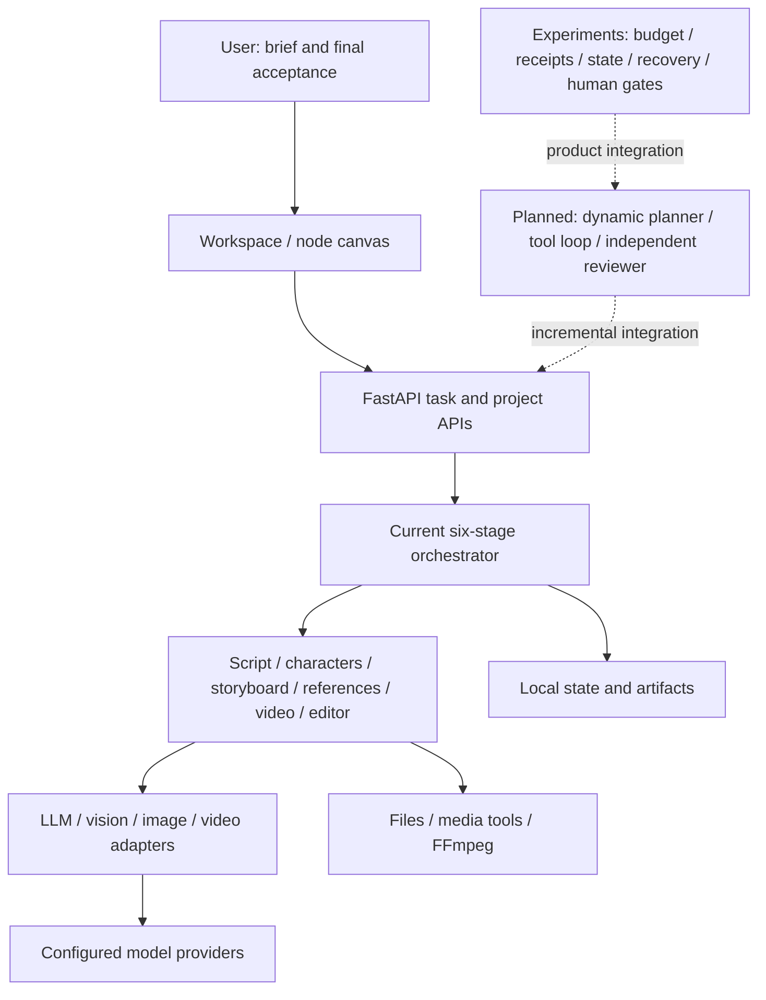

<div align="center">

# Leon TV

### An Agent Harness project for AI video creation

Turn ideas and scripts into storyboards, images, video clips and edited output—with visible, editable intermediate results.

[简体中文](./README.md) · **English**

[Video demos](#video-demos) · [Quick start](#quick-start) · [Architecture](#agent-harness-architecture) · [Status](#current-status) · [Roadmap](./docs/ROADMAP.md)


[](./LICENSE)

</div>

Leon TV is a locally hosted AI video workspace evolving toward an **Agent Harness**: a runtime that connects planning, model and tool calls, context, execution state, quality feedback and human acceptance.

The application currently provides a six-stage creative workflow, a node canvas, individual generation tools and specialized video pipelines. Real image generation and a two-model video trial have been completed. Durable state, bounded repairs, budget protection and recovery have separate experimental implementations; a fully autonomous product workflow is still under development. See the [architecture guide](./docs/ARCHITECTURE.md) for implementation boundaries.

## Video demos

These are real API-generated outputs using the same scene, reference image and first-attempt prompt. The motion preview shows MiniMax H3 on the left and Seedance 2.5 on the right. Full files include their generated audio.

[](./docs/DEMO.md)

| MiniMax H3 · 15 seconds | Seedance 2.5 · 15 seconds |
| :---: | :---: |
| [Play full video](https://github.com/user-attachments/assets/f9f2dc33-182f-47ab-af82-89b0430438e8) | [Play full video](https://github.com/user-attachments/assets/3f925daf-0cf4-498a-b58d-2f83b11b5bb6) |
| [Repository MP4](./docs/assets/demos/minimax-h3-15s.mp4) | [Repository MP4](./docs/assets/demos/seedance-2.5-15s.mp4) |

Both review exports are **720 × 1280, 9:16, 24 fps, 15 seconds, H.264 + AAC**. They were normalized with FFmpeg after generation and fully decoded for technical validation. These are feasibility samples with known content defects, including unwanted subtitles. Operator coordination and review were involved; the demos do not establish an autonomous product Harness. [Demo notes and file checksums](./docs/DEMO.md).

## What you can do

| Mode | Use case | Controls |
| --- | --- | --- |
| **Six-stage creation** | Develop an idea or story into video | Script, characters and scenes, storyboard, references, clips and editing, with intermediate review |
| **Node canvas** | Organize text, images, clips and creative relationships | Saved projects, connections, individual node runs, job state and previews |
| **Generation tools** | Test a prompt or model and make assets | Text-to-image, image-to-image and video generation with asynchronous tasks |
| **Specialized pipelines** | Explore quick videos, motion transfer and digital humans | Pipeline-specific inputs and model settings; availability depends on the configured provider |

```text
Idea / script → Script planning → Characters & scenes → Storyboard
                                                         ↓
Edited output ← Video clips ← Reference images ←──────────┘
```

The application saves intermediate results locally. Some character, reference-image and storyboard stages already contain evaluation, validation and bounded correction logic. Model clients separate text, vision, image and video integrations.

## Agent Harness architecture

A Harness manages the environment in which an Agent works: tool access, context, state, budget, checkpoints, quality feedback and recovery. Leon TV aims to support planning, generation, inspection and local repairs within a bounded task, followed by final human acceptance.



The current execution layer is a fixed stage state machine. Its stage handlers do not form an independently negotiating Agent team. Harness experiments validate supporting runtime mechanisms separately; the next step is to integrate them into the application APIs and UI. [Architecture details](./docs/ARCHITECTURE.md).

## Current status

| Capability | Status | Scope |
| --- | --- | --- |
| Six-stage workflow, projects and canvas | Implemented | Local application; generation requires provider credentials |
| Stage-level evaluation and bounded correction | Partial | Implemented in selected character, reference and storyboard paths |
| Real image and video output | Demonstrated in this trial | Actual outputs above; not certification of every model or parameter combination |
| Durable runtime, tool limits, budget and recovery | Experimental | Separate deterministic Harness PoC and controlled API trial |
| Dynamic planning, independent review and automatic repairs | Planned | Require an integrated production loop and recovery verification |
| Agent-to-Agent, long-term personal memory, Personal Agent | Future direction | Not currently delivered product capabilities |

## Quick start

Requirements: **Python 3.10+** (3.12 recommended), **Node.js 20.9+**, npm and preferably [uv](https://docs.astral.sh/uv/). Media processing uses system FFmpeg when available, with an `imageio-ffmpeg` binary fallback.

```bash
git clone https://github.com/leo-ai-pm/LeonTV.git
cd LeonTV
cd "Leon TV/Leon TV"
./install.sh
```

The installer installs dependencies, builds the frontend and creates a local configuration from the empty-key example if needed. On Windows, use `install.bat` in the same directory. See [installation notes](./docs/GETTING_STARTED.md) for manual setup and port configuration.

Start each terminal from the **repository root**:

```bash
# Terminal 1: backend
cd "Leon TV/Leon TV/backend"
uv run python api_server.py
```

```bash
# Terminal 2: frontend
cd "Leon TV/Leon TV/frontend"
npm run dev
```

Open **http://localhost:3000**. Backend health: **http://127.0.0.1:8000/api/health**.

Configure provider credentials and models in Settings, or edit the local `Leon TV/Leon TV/backend/config.yaml`. Start from [`config.yaml.example`](./Leon%20TV/Leon%20TV/backend/config.yaml.example). The real configuration is ignored by Git.

| Provider | Configuration | Integration |
| --- | --- | --- |
| OpenAI / Gemini / DeepSeek | `api_providers.openai / gemini / deepseek` | Text and vision, depending on model |
| DashScope | `api_providers.dashscope` | Qwen and Wan integrations |
| Volcengine Ark | `api_providers.ark` | Seedream and Seedance integrations |
| Kling | `api_providers.kling` | Video integration |
| Tudou API | `api_providers.tudou` | Channel models including this trial's `minimax-h3` and `seedance-2.5` |

Set credentials for the models you select. Supported durations, resolutions, reference modes and audio options vary. Catalog entries do not mean every combination has been tested. See the [model catalog](./Leon%20TV/Leon%20TV/backend/models/config_model.py).

## Repository layout

```text
LeonTV/
├── README.md / README_EN.md
├── docs/                          # Public architecture, setup, roadmap and demos
│   └── assets/demos/               # Actual MP4s, covers and motion preview
├── Leon TV/
│   ├── SKILL.md / references/      # Instructions for external Agent callers
│   └── Leon TV/
│       ├── backend/
│       │   ├── api/                # Routes, schemas and project storage
│       │   ├── core/               # Orchestrator and stage handlers
│       │   ├── models/             # Model catalog and provider adapters
│       │   ├── pipelines/          # Specialized workflows
│       │   ├── prompts/
│       │   ├── experiments/        # Harness PoC and controlled trial code
│       │   └── tests/
│       ├── frontend/              # Next.js and React Flow workspace
│       └── install.sh / install.bat
└── tests/                         # Installer checks
```

Runtime metadata lives under `backend/code/data/`, generated media under `backend/code/result/`, and private experimental state under `backend/harness_data/`. These directories, credentials and private production materials are excluded from publication.

## Development and roadmap

See [CONTRIBUTING.md](./CONTRIBUTING.md) for development checks. Priorities are:

1. Integrate execution state, budget and quality gates with the application APIs and UI.
2. Add dynamic planning, real tool feedback, independent review and local repairs.
3. Verify recovery across disconnects, restarts and uncertain provider acceptance.
4. Explore Agent collaboration, long-term memory and Personal Agent behavior after the creation loop is reliable.

[Milestones and acceptance goals](./docs/ROADMAP.md).

## FAQ

**Does generation happen entirely locally?** Projects and outputs are local. Remote model calls send the required prompts and assets to the configured provider, whose data policy and billing apply.

**Does the canvas run the entire graph automatically?** Nodes are currently run individually with asynchronous job tracking. Automatic DAG planning and execution are not implemented.

**Can I expose it as a public SaaS?** The current scope is personal local use. Multi-user authentication, tenant isolation, credential hosting and production operations require additional work. Keep the default local binding.

**Are the demos fully accepted?** They demonstrate real generation and valid media files. Known content defects remain, and dialogue and lip synchronization still require human review.

## License

LeonTV is developed and maintained by this project's maintainers. Public product entry points use the LeonTV brand.

This repository is distributed under the [MIT License](./LICENSE). Required third-party copyright and permission notices remain in the license file. Product naming changes do not alter ownership of incorporated code.
