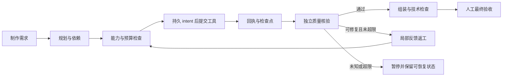

# LeonTV 架构

LeonTV 围绕 AI 视频创作组织执行能力，目标架构为 Agent Harness。当前创作以固定工作流为主，新增 Harness 测试运行基础已接入正式产品；以下区分实现范围与后续目标。

## 实现状态

| 层 | 当前实现 | 不应据此推导的能力 |
| --- | --- | --- |
| 创作输入层 | A「放映室」简报入口，剧本、要求及预算草稿的私有持久化、历史版本和冲突处理 | 保存即授权、已开始模型制作、已经形成报价 |
| 应用执行层 | 六阶段状态机、阶段 Agent、画布与任务 API、模型客户端、FFmpeg | 动态任务分解、自由多 Agent 协商 |
| 产品运行基础 | Studio 运行验证、正式 Harness API、私有持久状态、幂等键、版本/质量门禁、恢复与测试终审 | 真实模型规划、真实作品质量或生产验收；本切片仅 test/fixture |
| 简报规划层 | 保存版本冻结、正式持久任务、受限工具反馈与计划校验；正常待授权，独立离线响应驱动同一循环 | 真实模型已执行、生产费用控制已完成、计划语义或作品质量已接受 |
| 规划与首审交接 | D23在原任务、锁、日志和工作线程内自动交给独立Reviewer；合成场景保存五项首审与有限返工提案 | 真实内容质量已通过、已自动改稿／复核、真实角色协作已验收 |
| 有限改稿与独立复核 | D24在同一任务中接收受限修改的v2，独立逐条核对旧问题并重审五规则；合成执行、一次内容改稿上限 | 真实模型已自主改稿、无限返工、旧版审阅可用于新版、实际作品已接受 |
| 受控文本执行层 | 同一journal、报价/授权、累计账户与四角色；D26经验风险模式真实规划→首审通过，逐次核费后交接，默认关闭 | 内容改稿／复核已真实执行、最终账单已确认、通用核费连接器、媒体或人工验收通过 |
| 独立实验层 | 确定性 Harness PoC；受控真实 API 试制及预算/回执保护 | 正式产品入口已经具备自动规划、独立审查、自动修复 |
| 服务端执行控制 | D27独立配置、单任务准入、原引擎装配、平台导出收件箱及幂等恢复；默认关闭，旧范围只读 | 操作员配置UI、自动平台账单拉取、多供应商核费 |
| 素材交接层 | D28原journal只读证据桥、显式1–12镜素材合同、完整图片集修订合同及图片交付身份检查 | 已发新素材请求、已集成VLM、文本grant包含媒体权限 |
| 受控图片工具组件 | D29独立媒体描述符、原collector单次POST／GET、原始回执／文件技术校验和精确费用候选；默认关闭 | 单凭工具组件即可绕过独立媒体授权／账本调用、已完成自动素材调度或真实图片新调用 |
| 统一媒体账本 | D30媒体与D31素材文本共用原ExecutionStore；独立授权、保留风险、费用claim、交付与恢复；默认关闭 | 最终账单结清、视觉质量或生产启用 |
| 原生素材与图片操作端 | D31单次素材文本、核费证明清单，D32独立图片control／CLI；复用原journal，原生素材已真实核费 | 操作员写UI、自动审图、完整自主制作或最终人工接受 |
| 图片续接授权层 | D37原journal的quote／持久预留意图／activation，服务器固定实际父账本并核验唯一增量；意图起计入共享风险 | activation即派发许可、释放旧unknown、修改旧policy或重置消耗；本阶段固定`dispatch_ready=false`、`runtime_contract_pending=true` |
| 图片运行时续接 | D38同intent及既留4+1分配，原任务精确版本批准已落账，v2 permit、精确引用及统一候选门禁 | 通过实际120秒派发、已交付新媒体或已解除全局unknown；管理元数据与真实执行分别验收 |
| 真实续接派发 | D39原执行器单次HTTP200、精确task SUCCESS及¥0.04原生核费；同intent／预算不变 | reserve入口121.64秒未达目标，尚无新GET或图片交付；本地重复校验待优化，跨版本仅GET续查合同待实现 |
| 已受理任务观察续接 | D40独立仅GET批准，原collector取回第二镜，65.81秒入口链路，技术交付／重放通过 | 新生成POST权限、全部生成性能已验收、视觉质量或完整自主制作通过 |
| 图片提交单次校验 | D41普通v2每次权限决定只读一个新鲜snapshot，入口83.78秒；原响应超时后停为unknown | 原请求已确认受理、平台同时间窗候选可直接替代回执、第三镜已交付或第四镜可继续 |
| 图片响应生命周期 | D42新报价／authority／permit／claim明确区分提交与响应截止，原生链路已接线 | 旧unknown自动恢复、第三镜已交付、新合同真实慢响应验收通过或增加调用额度 |
| 内部参考图转换 | 独立报价绑定转换profile／encoder，原图与衍生证明并存；JPEG需显式允许 | 技术转换即视觉通过、自动裁剪或任意压缩 |
| 目标创作闭环 | 真实Planner／文字Reviewer已在显式范围走通；素材／视觉／视频及人工终验继续接入 | 已交付完整自主创作、标准 A2A、长期记忆或 Personal Agent |

D33的 `image_fee_inspection` 是独立只读操作端，复用历史control与原journal重建，不构造执行runtime或费用观察器。它将POST身份、导出、精确候选、既有费用、查询和交付分列；不会写claim或续权。其原直接请求身份诊断合同继续保留。D34另增加原生task quota证据及task/request全局去重，并通过原journal认领首镜¥0.04；独立代码续接沿用原scope/grant/有效期。第二镜续行停为unknown，未取得新交付；只读基准强烈指向重复历史校验耗尽时限，确切异常阶段仍缺证。该历史问题的后续修复见下文D35，续接预审见D36。[D34合同与实际边界](./TASK-FEE-CONTINUATION-VALIDATION.md)。[接口](./IMAGE-FEE-INSPECTION-API.md) · [真实只读验证](./IMAGE-FEE-INSPECTION-VALIDATION.md)。

D35在每次完整journal重建内复用严格完整输入的纯描述符证明，不缓存权限或省略逐帧业务校验；续接内部的纯文件采集复用当次已完成的权限判断，各独立调用和Key前后仍重新检查。新采集异常可封存私有固定阶段观察，由原status只读验证投影；该观察不表示确切异常原因、未发HTTP、零费用或重试许可，历史unknown不回填。原到期范围、消耗和风险保留。[D35接口与验收](./RUNTIME-VALIDATION-PERF-VALIDATION.md)。

D36的 `image_continuation_parent/proposal/operator` 只做可核验的续接预审：重建原历史、精确费用／交付、唯一unknown、实际代码与父分配，派生后续窗口及新替代版本，并在输出前复查漂移。D36当轮原329文件未改，旧runtime／账本仍拒绝到期范围，没有新派发通路；风险81.37／53次保持，82.37／54次当时仅为方案值。显式私有父文件只是观察，不能作为任意副本的写入权威；后续固定live来源的授权实现见D37。[D36合同与验收](./IMAGE-CONTINUATION-PREFLIGHT-VALIDATION.md)。

D37的 `image_validity_continuation`、`image_continuation_parent_io` 和 `image_validity_operator` 复用原任务锁、帧链与预算门禁，依次持久化quote、预留意图和activation。意图立即在共享包络保留新增1元／1次；父写入只接受固定实际路径下的原45条加唯一新分配，再以原生CAS记录激活。中断后风险继续保留，重放不重复分配，两个文件不被宣称为原子事务。合同包络为82.37元／54次，属于保守风险而非消费；原unknown、scope／grant、有效期及旧permit保持不变，activation不授予派发能力。[D37接口](./IMAGE-VALIDITY-CONTINUATION-API.md) · [实际写入与验收](./IMAGE-VALIDITY-CONTINUATION-VALIDATION.md)。

D38的 `image_runtime_continuation`、`image_continuation_funding`、`image_continuation_policy` 和显式运行时控制在同一个intent及已留4+1分配上建立新版本合同，新增风险／调用为0。D37原方案按真实quote出生前缀核验；新批准绑定精确代码和新lease，v2 permit以新operation／nonce及累计序号3、4、5区分第二镜替代attempt和后两镜，引用绑定明确的operation／query／delivery。两笔真实allocation及begin分别保留，原anchor不伪装为分配集合hash。原scope、grant、unknown及旧记录不变。运行时预留、派发／采集、媒体账本和共享预算共用精确候选门禁，文字／素材和其他scope不能借用例外。

该候选门禁阻止新unknown、待核费或超额后的新付费POST；已明确accepted task的显式有界GET仍须满足当前revision／lease／grant／code／funding及父POST绑定，不自动查询或重试。跨revision不移植旧POST来续GET，只读恢复及费用／交付导入继续处理原事实。D38当轮的精确版本批准已独立验收，当时没有新请求；后续真实执行见D39。[D38接口](./IMAGE-RUNTIME-CONTINUATION-API.md) · [D38实际验收](./IMAGE-RUNTIME-CONTINUATION-VALIDATION.md)。

D39在原任务追加同intent的lease批准后，用原会话派发一次第二镜attempt2，HTTP200受理；精确task的SUCCESS与¥0.04quota已原生认领。签发到collector106.792秒，入口到collector121.635秒，入口性能目标未通过。原62帧读取约6.3秒，后续GET复制完整父POST和引用，当前16次完整历史重建路径缺乏时限余量，故未新查询或交付。下一实现须同时处理同次校验复用与显式仅GET观察续接；新代码／lease不能借新批准直接迁移旧POST。预算、旧unknown、次数和原回执保持。[D39实测、费用及未完成项](./IMAGE-DISPATCH-ACCEPTANCE-VALIDATION.md)。

D40的 `image_observation_continuation/policy/control/runtime/operator` 在原media命名空间批准仅GET观察；compact descriptor保留原POST一次，原collector核对完整受理回执。每个Key边界和最终采集分别获取新鲜snapshot，同一次判断内做纯候选检查；普通v2路径保持。引用证明仅在单次历史校验内作有界纯复用。实际第二镜原PNG720×1280已交付，原生69帧／POST3／GET3／交付2／费用2，父46条与预算保持；观察GET入口65.808秒、签发51.633秒，均在120秒内。普通POST仍须优化后再生成后两镜，质量及人工验收待完成。[D40合同](./IMAGE-OBSERVATION-CONTINUATION-API.md) · [实测与边界](./IMAGE-OBSERVATION-CONTINUATION-VALIDATION.md)。

D41将同次snapshot复用接入普通v2 POST，显式control与root／activation／guard方法绑定；三个安全边界各自重新读取，事务payload仍须与真实head一致。无新生产模块，4个原模块修改，2个测试文件新增。第三镜真实提交到collector为83.780秒，原120秒permit未延长；剩余响应观察时间约56.165秒后collector按绝对期限关闭，无原raw。新增unknown阻止第四镜，平台SUCCESS与502候选缺客户端标识，仅作未绑定观察保留。此处暴露的期限耦合由D42的新版本合同处理，旧permit和unknown不追溯改写。[D41证据及边界](./IMAGE-SUBMIT-SNAPSHOT-VALIDATION.md)。

D42在原运行报价中增加明确响应策略：v3 authority、schema4 permit与claim2绑定响应窗口，派发保持120秒，响应截止最多为签发后300秒。原native账本、candidate gate和父资金继续生效；旧合同原样可重建，新unknown即使换窗口或续期也不解除。实际任务74帧与2／4交付保持，未新增真实生成，下一步是第三镜精确对账与未知风险处置。[D42合同](./IMAGE-RESPONSE-LIFECYCLE-API.md) · [验收](./IMAGE-RESPONSE-LIFECYCLE-VALIDATION.md)。

## 现役创作链路

前端使用 Next.js、React、TypeScript、Tailwind CSS 与 React Flow。FastAPI 后端负责会话、项目、阶段执行、生成任务与媒体访问。

`backend/core/orchestrator.py` 中的 `WorkflowEngine` 按 `STAGE_ORDER` 调度六个阶段。状态保存在 `WorkflowState`，阶段结果写入共享的 `artifacts` 与元数据，并持久化到本地。

| 阶段 | 处理器 | 职责 |
| --- | --- | --- |
| 剧本 | `ScriptWriterAgent` | 将输入整理成结构化剧本与场次 |
| 角色与场景 | `CharacterDesignerAgent` | 角色、场景设计与相关素材 |
| 分镜 | `StoryboardAgent` | 镜头规划、结构校验与连续性约束 |
| 参考图 | `ReferenceGeneratorAgent` | 为后续视频生成准备画面参考 |
| 视频 | `VideoDirectorAgent` | 调用选定视频模型生成片段 |
| 后期 | `VideoEditorAgent` | 通过 FFmpeg 合成选定片段 |

这些 Agent 是由一个编排器调用的阶段处理器。角色与参考图阶段已有局部“生成—VLM评估—反馈—有限重生”路径，分镜也有结构校验与修正逻辑；它们还没有组成独立、通用的跨阶段 Reviewer。

当前视频生成策略包括首帧、首尾帧和角色/场景参考，具体可用组合受所选模型、服务商和适配器能力约束。后期为媒体合成流程，尚未提供专业多轨时间线编辑器。

## 产品入口

路径均相对 `Leon TV/Leon TV/backend/`：

| 接口模块 | 用途 |
| --- | --- |
| `api/routers/workflow.py` | 工作流阶段执行、进度与确认 |
| `api/routers/studio.py` | 画布项目与节点数据 |
| `api/routers/sandbox.py` | 单次图像/视频生成与异步任务 |
| `api/routers/pipelines.py` | 专项短流程任务 |
| `api/routers/configuration.py` | 本地模型与服务商配置 |
| `api/routers/creator.py` | 创作简报的创建、摘要查回、全文及历史读取、显式版本更新；不执行制作 |
| `api/routers/harness.py` | 零付费测试运行、查回、事件、受控媒体、动作与测试终审 |

自由画布由用户连接并运行节点。节点与连线形成创作关系，前端负责展示运行状态和结果；完整 DAG 的自动调度与自主规划尚未实现。

## 模型与工具

D30的 `media_ledger/media_runtime` 复用原执行journal、任务锁及D29 collector，采用独立媒体授权与费用来源。原文本账户不扩限；媒体从父范围全额度继承，unknown、待核费及超额经统一门禁停止新派发。费用及全局claim同帧记录，旧平台别名仅凭原导出建立映射。只读媒体API不加载密钥／恢复任务；D32已补独立图片操作端，仍须显式配置及授权。[合同](./MEDIA-EXECUTION-API.md) · [验收](./MEDIA-EXECUTION-VALIDATION.md)。

D31的 `asset_design/asset_design_ledger` 在同一journal显式增加素材文本范围，独立报价／授权、一次调用和核费后发布严格清单；`asset_control/asset_operator` 校验私有配置、父分配begin、代码manifest和接受版本，只有显式start加载密钥。`scope_budget` 保留原账户及全部素材／图片范围的冻结预算和次数，并对canonical fee作带工具身份的全局去重；三个通道共用未知／待核费／超额门禁。`asset_media_handoff` 重建确切raw、费用导出／claim和manifest证明，图片范围另行授权。可选 `reference_derivation` 绑定原交付、目标请求和报价encoder，保留原字节，显式允许时才压JPEG；默认旧格式/hash不变。新只读状态API不写入或恢复；默认应用及生产继续关闭；D32已完成真实素材清单及核费，视觉和人工验收仍待完成。[合同](./ASSET-DESIGN-API.md) · [验收](./ASSET-DESIGN-VALIDATION.md)。

D29新增 `image_policy/image_capture/image_receipts/image_fees`，以明确的媒体scope复用原ReceiptStore和detached worker；worker仅为新kind选择固定POST／GET，旧文本路径仍为原POST。组件不另建调度和金融账本；独立verifier须核对实际媒体预留、grant、原始提交与引用字节，默认未注册。费用仅按生成请求ID精确产生候选，未做全局claim／结算或释放风险；迟到证据保留事实，不恢复执行。[合同](./CONTROLLED-IMAGE-TOOLS-API.md) · [验收](./CONTROLLED-IMAGE-TOOLS-VALIDATION.md)。

D28在原执行API增加 `GET .../execution/asset-handoff`，从已验证的原始调用、已匹配费用及确切接受报告派生素材准备，不创建第二套执行引擎。v1首审与v2完整复核各自重建，显式 `product-assets-v1` 支持1–12镜并保留旧D19。原视觉合同仅在新profile显式选择新校验器，图片集变更后旧审阅失效。土豆图片客户端以交付SHA／大小校验缓存，过期链接只查询原task恢复。它们不授予新付费权限；媒体工具、异步图片费用和真实视觉执行仍待接入。[接口](./PRODUCT-ASSET-HANDOFF-API.md) · [验收](./PRODUCT-ASSET-HANDOFF-VALIDATION.md)。

`backend/models/` 将 LLM、VLM、图像与视频服务商隔离在适配层；`config_model.py` 提供型号与能力目录。模型选项、适配器支持和实际服务商验证是不同的证据层，不能仅凭目录条目判定一个模式稳定可用。

`backend/media_tools.py` 优先使用系统 FFmpeg，缺失时尝试 `imageio-ffmpeg` 的二进制。模型生成、素材读取、结果下载和本地媒体处理分别保留其成功与失败状态。

外层 `Leon TV/SKILL.md` 和 `references/` 是给外部 Agent 的调用说明，不是产品内已实现的 Skill 发现、加载和沙箱权限系统。

D32的 `image_control/image_operator` 从确切原生素材证明装配图片工具，严格继承完整父预算与次数，独立报价／授权／预留后才可单次POST。原POST请求ID核费、原task的有界GET和本地图片导入分别记录；密钥仅在实际网络派发且前后校验均通过时加载。历史媒体scope复用出生时的冻结交接，不因另一任务后来完成而重新占用原allocation。每次权限校验内只读一个独立snapshot，无跨请求授权缓存。默认bootstrap、UI和写HTTP未扩展；自动视觉审阅和后续制作仍待接入。[接口](./IMAGE-OPERATOR-API.md) · [验收](./IMAGE-OPERATOR-VALIDATION.md)。

## 创作简报与来源版本

默认入口 `/creator` 使用 A「放映室」布局，保存剧本、制作要求和预算草稿。`/api/creator/briefs` 将正文与不可变逻辑快照保存在私有 `harness_data/creator_briefs/`，列表和按键查回仅返回摘要；正文通过明确的简报 ID 读取。创建、更新请求键及快照在跨进程锁内原子提交，过期版本返回冲突。来源摘要由服务端按原文计算，剧本文本变化才递增来源版本。

浏览器只持久请求键、简报 ID、预期版本及摘要等恢复元数据，正文留在当前编辑器内存与后端。已保存内容可刷新恢复；未提交的输入在刷新后无法保证恢复。版本冲突保留本地稿，需显式核对再保存。

本版固定 15 秒、9:16、写实影视。预算为待定或金额草稿，全部版本恒为 `not_authorized`、`execution_enabled=false`。保存不会创建 Harness run、调用模型、生成媒体或产生费用；Brief 可另外创建持久规划任务；真实模型执行和制作连接仍待实现。[D07 接口合同](./CREATOR-BRIEF-API.md)。旧六阶段入口为 `/workflow`，既有根路径 session/stage 深链保持兼容。

## 简报规划与受限工具循环

`/creator` 的规划区通过 `/api/planner` 只提交已保存的 `brief_id`、明确 revision 与请求键。服务端冻结剧本、制作要求、规格、预算和来源元数据，计算完整 `snapshot_hash`；剧本自身的 `source_hash` 不能替代它。后续改稿不改变旧任务。

`core/planner/runtime.py` 在每次模型步骤前持久调用意图，收到响应后先保存回执，再执行白名单工具。工具只有读取冻结 Brief 和提交分镜计划，严格 JSON 校验来源、15秒总时长、唯一镜头与无环依赖；错误反馈进入下一步上下文，受6步、2次错误及字节上限约束。计划结构合格后质量仍为 `not_reviewed`。

正常任务没有许可时停在 `awaiting_authorization`，创建、读取或恢复不调用模型。高级 `offline_test` 使用合成模型响应，实际运行相同的任务、工具、反馈、校验和持久恢复代码。确认回执恢复时复用；未确认调用进入未知状态，停止也不清除未决信息，不会自动重调。私有状态位于 `harness_data/brief_planner/`，列表与事件只投影安全元数据，完整冻结正文通过明确的 source 读取。

D08自身的正常任务不签发真实执行授权；D09在独立执行记录中增加持久授权/预占与保守回执处理，生产仍默认关闭，实际供应商协议和计费边界须另验。不能由此宣称已交付完整自主 Harness。[D08合同](./BRIEF-PLANNER-API.md) · [验证范围](./BRIEF-PLANNER-VALIDATION.md)。

D23复用这条任务链路：新合成场景接收严格计划后，worker自动委派Reviewer，以完整来源、确切计划版本和规则重建独立的system＋user上下文。Reviewer不继承Planner历史或执行其工具；首审报告与返工提案绑定来源、计划和规则摘要，存储每次读写都重建核验。角色共用累计6次意图上限、1次Reviewer上限、持久intent／receipt、停止与恢复；没有回执不自动重调，已有回执只处理一次。新场景追加明确的collaboration投影，列表不含报告正文；原场景字段与历史摘要保持兼容。`quality_status`仍为`not_reviewed`，normal执行关闭。D23本身不执行改稿或复核，后续D24合成路径见下；真实模型授权衔接仍待完成。[交接合同](./PLANNER-COLLABORATION-API.md) · [验收范围](./PLANNER-COLLABORATION-VALIDATION.md)。

D24新增独立的合成改稿场景，旧D23语义保持不变。首审拒绝且确有可改范围时，同一worker接着委派Repairer；回执须原样回显服务端的任务／操作／父计划／报告／提案绑定，候选只改允许字段才追加v2。Rechecker使用新上下文、完整来源和五规则，绑定v1拒绝报告及实际v2，逐项列出旧问题resolved／unresolved／unknown；它也能发现新问题，不能仅凭已改字段放行。四角色共用6次意图上限，首审、改稿、复核各最多一次；无回执不重调，已有回执恢复复用。首审已合格不制造返工，缺证不补造事实，复核再拒绝或缺证就停止，不自动生成v3。原首审和修订合同保持原字节，新复核合同明确只允许v1→v2。D24合成质量不计真实验收；D25受控文本执行见下，真实协作实测、媒体与人工终验仍待完成。[改稿／复核合同](./PLANNER-REVISION-CYCLE-API.md) · [验收范围](./PLANNER-REVISION-CYCLE-VALIDATION.md)。

## 受控文本执行与账本

D27将范围配置与费用桥提升为正式服务端模块：`core/execution/control.py` 冻结原授权、父账本、完整代码和单个任务来源；`bootstrap.py` 通过普通三个产品工厂装配原执行引擎，观察模式不恢复或写旧记录；`fees.py` 保存平台原始导出、唯一请求身份、prepared费证及ACK。`operator.py` 只提供本地安装／状态／导入命令，不启动模型。默认关闭，启用仍需原报价、授权与单独续行；重启后旧费证仅记账，不能借重放自动开始新调用。原D26日志四条费证已通过适配器只读回放，原分镜和journal不迁移。[合同](./EXECUTION-CONTROL-API.md) · [验收](./EXECUTION-CONTROL-VALIDATION.md)。

D25将四个文本角色接入同一个 `ExecutionRuntime`、授权、账户累计额度与回执链路。服务端显式profile冻结在首次报价，四角色范围进入披露摘要和新授权；旧任务及授权不静默升级。角色委派使用原worker和单次受控HTTP，不为审核、改稿另建预算；已确认计费回执即使内容非法也计价并停止，未知保留预占。新profile历史身份、首次回执、已结算金额和授权引用经逐帧约束与完整角色重建核对。前端只读展示角色、版本和逐操作回执，历史环境由本任务记录确定。模型响应以合成传输验收；正式生产仍关闭，真实四角色、媒体与人工终验未完成。[D25合同](./PLANNER-ROLE-EXECUTION-API.md)。

`core/execution/`为D08正常任务增加独立执行记录：首次复制并绑定原完整冻结源，随后消息、授权、预占、调用意图、回执与计划在同一个私有journal中提交，不回写旧D08状态。前端主流程显示实际规划执行状态，旧记录作为来源查看；离线D08任务不能升级到此入口。

报价从服务端精确策略生成，授权绑定报价披露、任务与快照；授权不自动开始。派发前在同一锁内核验有效期/撤销/累计金额与次数，并实际计算绑定策略的可信输入token上界；原子记录hold、intent、permit和call count，释放总锁后才进行单次HTTP。逐任务执行锁防止重复派发，未知调用不自动重发。

原始回执先持久化，再严格检查ID/model/finish reason/usage；完整回执按冻结费率计算六位小数的本地金额，替换原预占。缺失、歧义、截断或超界保留hold；reconcile只处理已有回执，无客户端写账和虚构供应商账单接口。账户身份在journal内固定，停启、换策略或新grant不重置历史暴露。

私有`harness_data/planner_execution/`使用变更记录、摘要链、独立head和原子替换，减少全局状态重复保存；拒绝损坏与符号链接，静态树双向隔离。生产bootstrap为disabled，没有策略/Key/可信bounder，不从旧配置或预算签发许可。真实服务商接入与输入计费边界须另行核实。[D09合同](./PLANNER-EXECUTION-API.md) · [验证](./PLANNER-EXECUTION-VALIDATION.md)。

D10使`wire_api`成为显式服务端策略：保留旧Chat请求和历史摘要，新增Responses固定文本请求，协议同时绑定报价、操作许可和实际wire。无流式、远端会话续链、内置工具或自动fallback。Responses必须完成、无错误、模型与ID匹配，并严格接受单一文本动作；reasoning内容仅私有保留，cached/reasoning计数是总用量子集，不额外相加或扣除。未知用量、工具或计费维度保留预占，不能把返回文本当成已结账。协议适配与供应商实际支持分开验收。[D10合同](./PLANNER-RESPONSES-API.md) · [验证边界](./PLANNER-RESPONSES-VALIDATION.md)。

D11增加固定Chat输出参数；D12补未确认操作的私有诊断及完整工具参数提示；D13增加显式开启的固定字段诊断，正式调用默认反馈与判据保持兼容。新任务实际读取来源成功，提交时120秒无回执而停止，两条未知风险保留；生产关闭，尚无正式分镜质量通过。[最新验证](./PLANNER-CONTRACT-VALIDATION.md)。总控委派、独立审阅、版本化局部返工及最终人工验收已确认为[自主协作目标](./AUTONOMOUS-COLLABORATION-GOAL.md)，目标与已实现运行能力分开。

D14增加服务端显式开启的独立回执采集：先持久化原许可和调用意图，再启动独立解释器，完整记录与提交凭据落盘后才通知观察者。原截止时间与有界清理窗口限制采集；迟到或冲突证据保持隔离。新增 `GET /api/planner/tasks/{task_id}/execution/operations/{operation_id}/receipts/inspect` 和本地 inspect CLI，仅读取已有快照与证据，不走旧查看接口的恢复事务，也不结算、释放预留或继续执行。合成故障验收已通过，默认关闭，生产未启用；旧未知没有因此恢复，也无新的真实分镜或内容接受。[实现合同](./PLANNER-RECEIPT-RECOVERY-API.md) · [最新验证](./PLANNER-RECEIPT-RECOVERY-VALIDATION.md)。

D15抽出中性`capture_once`接缝：正式`CapturedTransport`先执行原policy／journal／permit校验，独立`experiments/planner_live`则接收可信服务端提供的冻结经验风险描述符，两者复用同一worker与回执库。实验适配器只核对意图、实际预留／begin引用、context／原wire及截止时间的关联，不独立证明账本余额或计费硬界，也不执行工具或结算。实际父账本和逐笔核费由私有控制器负责；费用未确认不发下一请求，新unknown停止。代码与合成接入通过，首次真实请求已保存完整HTTP200，但旧caller不接受缺HTTP ID及新增reasoning usage形状，在工具前停止；费用观察不恢复原trial，正式生产仍关闭。[D15接口](./PLANNER-EMPIRICAL-CAPTURE-API.md) · [验收与剩余工作](./PLANNER-LIVE-VALIDATION.md)。

D16在独立实验层新增纯Chat回执解码器，允许确实缺失的HTTP请求ID，强制保留真实正文ID，单列completion内的reasoning子计数；可选body SHA须匹配原文。原正式normalizer、工具判据和采集文件均未改。内容原串仍由原工具检查，实际费用以独立平台行唯一关联；解码本身不处理账本、工具或恢复。[接口](./PLANNER-CHAT-RECEIPT-API.md) · [验收](./PLANNER-CHAT-RECEIPT-VALIDATION.md)。

D16的真实续试执行了读源工具，核费后第二次分镜请求因length截断停止，未取得计划；该次保守保留unknown风险，HTTP完整、截断输出与费用观察分别记录。后续D17处理上下文继承与长输出，不改写这次历史结果。

D17增加纯历史读源证明与完整HTTP／截断输出分层。只有通过独立锚点及原source、descriptor、wire、及时raw、工具反馈和核费关联验证的成功前缀才能继承；不带入后续unknown尾部或私有思考文本，新意图另行冻结并预留。真实F01已提交3镜头、15秒、9:16计划，平台核费后为 `plan_ready`；结构通过，独立Reviewer尚未执行。原累计4次范围已用完，正式生产未开启。[接口](./PLANNER-READ-CONTEXT-API.md) · [验收](./PLANNER-READ-CONTEXT-VALIDATION.md)。

D18增加 `core/planner/review.py` 的独立输入／严格输出合同，以及 `repair.py` 的版本绑定、最小编辑范围和候选约束。Reviewer使用完整冻结来源、原计划和五项规则，独立两消息上下文；不读取生成者推理，输出合法性与判断真实性分开。实际R01对F01 v1的五项判断均 accepted，核费后 `review_completed`；本次无返工任务。真实改稿／复审未执行，没有新增HTTP路由或正式生产开放。[接口](./PLANNER-REVIEW-API.md) · [验收](./PLANNER-REVIEW-VALIDATION.md)。

D19增加 `core/planner/assets.py` 的严格素材清单与首帧文本任务；共享定型由程序逐镜注入，来源、计划、accepted审阅和清单摘要绑定。受控实测已交付三张真实首帧，含原任务GET恢复及一次独立失败重试；正式产品HTTP入口未新增，视觉审阅／内容返工仍待接入。原生媒体尺寸与格式、转存PNG的像素一致性、平台收费及退款分别记录。[合同](./ASSET-HANDOFF-API.md) · [实测](./ASSET-HANDOFF-VALIDATION.md)。

D20新增 `core/planner/asset_review.py` 的完整图片集绑定、严格三态审阅和局部图片版本合同。受控实际首帧经过独立 Codex 看图、三次指定修订与全组合复核后通过；来源、分镜和清单仍为v1。实际执行由统筹冻结的私有调用器控制，纯合同随后回放实际版本链；未新增产品视觉模型、调度或HTTP入口。平台关联恢复的证据强度与原始POST回执分开记录。[合同](./ASSET-VISUAL-REVIEW-API.md) · [验收](./ASSET-VISUAL-REVIEW-VALIDATION.md)。

D21准备层增加 `core/planner/video_brief.py`：从确切 accepted 图片集及原分镜编译模型共用输入，绑定图片版本1/3/2、原4/5/6秒连续时码、15秒/9:16及独立冻结摘要。232个公开文件的冻结清单未变，既有全量1201项测试及5个子测试通过；本次未改代码，新增私有兼容入口的5项合成检查单独通过，不等于产品调度或核费集成。[交接合同](./VIDEO-BRIEF-API.md)。

2026-10-24经用户批准重建浏览器、恢复土豆登录并核对720p规格/价格及三张参考图后，D21向MiniMax H3与Seedance 2.5各发起1次真实POST。两者均为HTTP502 `fail_to_fetch_task`，正文含上游failed、HTTP503 `model_not_found` / `No available channel`，没有可用本平台任务编号、新视频/音频或媒体/人工验收。每次本地POST对应3条平台错误记录，仍是共2次本地提交；对应记录均显示¥0，只是平台费用观察，不是正式账单或计费硬界。原39操作/4条unknown保持，累计41操作、15次续试提交；继承原100元预算，累计风险69.37元保留，不是消费，也不释放新失败风险。H3累计3/3、Seedance 2/3，本轮2次范围已耗尽。当前由供应商通道故障阻断，须恢复原通道或由用户选择可用替代渠道/模型，再冻结新范围；不自动重试或切换模型。正式产品视频调度、VLM和核费集成仍待完成，production/default capture继续关闭，自主协作仍未整体验收。[D21实际结果与边界](./VIDEO-GENERATION-VALIDATION.md)。

D22核对了土豆可见令牌权限与官方视频文档，保留原生成入口和模型参数。公共 `TudouClient` 的视频生成／恢复改用同路径锁，按文件摘要复用交付，终态不重提，业务失败不接收任务编号；仅在完成缓存的媒体地址失效时对原任务作一次受限GET刷新。既有完成证据不会被刷新故障降为unknown。没有更改实际密钥、分组、预算或生产开关，没有新增生成调用；D21私有控制器的上游失败仍是独立阻断。详见[排查与验证](./TUDOU-VIDEO-API-DIAGNOSIS.md)。

## 产品内 Harness 运行基础

Studio 画布右上角的「运行验证 · 测试」连接 `/api/harness/runs`。`core/harness/` 使用真实文件存储与后台执行器，只有 Planner、供应商和 Reviewer 使用确定性测试实现。测试媒体为专用 TEST 合成片段，不引用旧付费样片。

客户端在创建前保存请求键和原参数；服务端对业务参数计算摘要，在同一原子事务内建立运行、键索引和项目关联。响应丢失可按原键查回，同键变参拒绝；读取与事件重放不会派发工具。画布来源在此切片只绑定摘要和稳定记录 ID，未验证剧本语义。

私有 `harness_data/product_runs/` 位于静态挂载之外。状态、单调事件序号、操作回执与额度一起落盘；跨进程文件锁限制同一运行的执行。快照和事件仅返回白名单字段。媒体按运行/产物 ID 与版本读取，并核对摘要，不接受任意路径。

测试计划是 `reference → shot → final`。执行成功与质量通过分开保存；审查绑定产物哈希、版本、依赖和规则。改版使受影响后代及旧判断失效，保留历史版本。最终测试决定在同一锁定事务内重新核验文件、依赖、审查与 manifest，不能仅凭相同成片哈希放行旧证据。

测试执行次数有全局上限。存在 `submitting/unknown` 操作时，停止不会抹除未决状态，不能通过改版或续跑绕过对账；对账只查询原操作。进程重建后查回检查点，读取不自动重提，显式恢复复用已完成产物。

界面与响应始终标记 `test/fixture`，模型和付费调用为零；质量通过、局部返工与最终决定只证明测试机制。真实生产的费用预占、供应商差异、内容 Reviewer、音画与人物质量仍须另行接入和验收。[接口合同](./HARNESS-RUNTIME-API.md) · [验证记录](./HARNESS-RUNTIME-VALIDATION.md)。

## Harness 实验

### 确定性本地 PoC

`backend/experiments/harness_poc/` 是可独立运行的实验，验证工具白名单、持久状态、有限修正、超时与恢复、产物校验和绑定版本的人工终审。Planner、Worker 和 Reviewer 使用确定性实现；该实验不调用真实 LLM，也不证明自主生成质量。使用说明见 [`HARNESS-POC.md`](../Leon%20TV/Leon%20TV/backend/docs/HARNESS-POC.md)。

### 受控真实 API 试制

`backend/experiments/tudou_ab/` 支持一请求一记录的真实试制，包含请求前预算预占、提交 intent、任务回执、受理不明时禁止重发、媒体交付绑定以及技术规格检查。

该执行器依赖本地私有授权与材料，公开代码不附带授权文件、原文、密钥、账本或签名媒体链接。它不是可直接启动的通用产品任务入口。公开的两条结果与验证范围见 [DEMO.md](./DEMO.md)。

预算保护使用已核对报价的保守预占；预占、实际扣款与未核清费用必须分别记录，不能把未结算金额当作零成本。

## 目标运行合同

在已接入的测试运行基础上，下一步连接真实模型和创作工具，形成以下闭环：

这是完整生产闭环的设计目标。测试运行已验证下列机制，接入真实供应商时仍须重新验证对应行为：

- 相同创建键重试可查回原运行，变更参数不能冒用同一键。
- 远端是否受理不明时先查回，不盲目重复付费提交。
- 运行与质量状态分开；工具返回成功不自动标记内容合格。
- 预算、超时和修复次数有明确上限，未知费用保留风险占用。
- 核验与人工决定绑定当前产物版本和哈希，旧版本决定不能放行新产物。
- 刷新、断线或重启可以恢复检查点；私有状态位于公开媒体挂载之外。

## 数据与部署边界

本地运行数据位于 `backend/code/data/`，生成媒体位于 `backend/code/result/`；Harness 产品运行与实验私有状态位于 `backend/harness_data/`。这些资料不提交到公共仓库。

默认部署是单用户本机 Web 应用。它保存本地项目，但远程模型会接收完成调用所需的提示词和素材。公共 SaaS 的身份认证、租户隔离、凭据托管、配额及运维不是当前已完成的部署能力。
