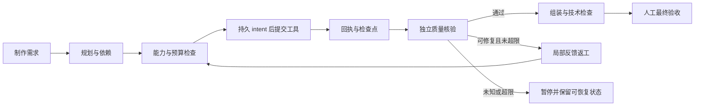

# LeonTV 架构

LeonTV 围绕 AI 视频创作组织执行能力，目标架构为 Agent Harness。当前创作以固定工作流为主，新增 Harness 测试运行基础已接入正式产品；以下区分实现范围与后续目标。

## 实现状态

| 层 | 当前实现 | 不应据此推导的能力 |
| --- | --- | --- |
| 创作输入层 | A「放映室」简报入口，剧本、要求及预算草稿的私有持久化、历史版本和冲突处理 | 保存即授权、已开始模型制作、已经形成报价 |
| 应用执行层 | 六阶段状态机、阶段 Agent、画布与任务 API、模型客户端、FFmpeg | 动态任务分解、自由多 Agent 协商 |
| 产品运行基础 | Studio 运行验证、正式 Harness API、私有持久状态、幂等键、版本/质量门禁、恢复与测试终审 | 真实模型规划、真实作品质量或生产验收；本切片仅 test/fixture |
| 简报规划层 | 保存版本冻结、正式持久任务、受限工具反馈与计划校验；正常待授权，独立离线响应驱动同一循环 | 真实模型已执行、生产费用控制已完成、计划语义或作品质量已接受 |
| 受控文本执行层 | 独立执行journal、服务端报价/授权、原子费用预占、累计限额、可信输入上界、回执归一与本地计价；默认关闭，仅合成传输验收 | 真实供应商账单已核实、文本模型已完成实测、已生成或接受内容 |
| 独立实验层 | 确定性 Harness PoC；受控真实 API 试制及预算/回执保护 | 正式产品入口已经具备自动规划、独立审查、自动修复 |
| 目标创作闭环 | 真实模型驱动的 Planner、独立 Reviewer 与生产局部返工待接入运行基础 | 已交付完整自主创作、标准 A2A、长期记忆或 Personal Agent |

## 现役创作链路

前端使用 Next.js、React、TypeScript、Tailwind CSS 与 React Flow。FastAPI 后端负责会话、项目、阶段执行、生成任务与媒体访问。

`backend/core/orchestrator.py` 中的 `WorkflowEngine` 按 `STAGE_ORDER` 调度六个阶段。状态保存在 `WorkflowState`，阶段结果写入共享的 `artifacts` 与元数据，并持久化到本地。

| 阶段 | 处理器 | 职责 |
| --- | --- | --- |
| 剧本 | `ScriptWriterAgent` | 将输入整理成结构化剧本与场次 |
| 角色与场景 | `CharacterDesignerAgent` | 角色、场景设计与相关素材 |
| 分镜 | `StoryboardAgent` | 镜头规划、结构校验与连续性约束 |
| 参考图 | `ReferenceGeneratorAgent` | 为后续视频生成准备画面参考 |
| 视频 | `VideoDirectorAgent` | 调用选定视频模型生成片段 |
| 后期 | `VideoEditorAgent` | 通过 FFmpeg 合成选定片段 |

这些 Agent 是由一个编排器调用的阶段处理器。角色与参考图阶段已有局部“生成—VLM评估—反馈—有限重生”路径，分镜也有结构校验与修正逻辑；它们还没有组成独立、通用的跨阶段 Reviewer。

当前视频生成策略包括首帧、首尾帧和角色/场景参考，具体可用组合受所选模型、服务商和适配器能力约束。后期为媒体合成流程，尚未提供专业多轨时间线编辑器。

## 产品入口

路径均相对 `Leon TV/Leon TV/backend/`：

| 接口模块 | 用途 |
| --- | --- |
| `api/routers/workflow.py` | 工作流阶段执行、进度与确认 |
| `api/routers/studio.py` | 画布项目与节点数据 |
| `api/routers/sandbox.py` | 单次图像/视频生成与异步任务 |
| `api/routers/pipelines.py` | 专项短流程任务 |
| `api/routers/configuration.py` | 本地模型与服务商配置 |
| `api/routers/creator.py` | 创作简报的创建、摘要查回、全文及历史读取、显式版本更新；不执行制作 |
| `api/routers/harness.py` | 零付费测试运行、查回、事件、受控媒体、动作与测试终审 |

自由画布由用户连接并运行节点。节点与连线形成创作关系，前端负责展示运行状态和结果；完整 DAG 的自动调度与自主规划尚未实现。

## 模型与工具

`backend/models/` 将 LLM、VLM、图像与视频服务商隔离在适配层；`config_model.py` 提供型号与能力目录。模型选项、适配器支持和实际服务商验证是不同的证据层，不能仅凭目录条目判定一个模式稳定可用。

`backend/media_tools.py` 优先使用系统 FFmpeg，缺失时尝试 `imageio-ffmpeg` 的二进制。模型生成、素材读取、结果下载和本地媒体处理分别保留其成功与失败状态。

外层 `Leon TV/SKILL.md` 和 `references/` 是给外部 Agent 的调用说明，不是产品内已实现的 Skill 发现、加载和沙箱权限系统。

## 创作简报与来源版本

默认入口 `/creator` 使用 A「放映室」布局，保存剧本、制作要求和预算草稿。`/api/creator/briefs` 将正文与不可变逻辑快照保存在私有 `harness_data/creator_briefs/`，列表和按键查回仅返回摘要；正文通过明确的简报 ID 读取。创建、更新请求键及快照在跨进程锁内原子提交，过期版本返回冲突。来源摘要由服务端按原文计算，剧本文本变化才递增来源版本。

浏览器只持久请求键、简报 ID、预期版本及摘要等恢复元数据，正文留在当前编辑器内存与后端。已保存内容可刷新恢复；未提交的输入在刷新后无法保证恢复。版本冲突保留本地稿，需显式核对再保存。

本版固定 15 秒、9:16、写实影视。预算为待定或金额草稿，全部版本恒为 `not_authorized`、`execution_enabled=false`。保存不会创建 Harness run、调用模型、生成媒体或产生费用；Brief 可另外创建持久规划任务；真实模型执行和制作连接仍待实现。[D07 接口合同](./CREATOR-BRIEF-API.md)。旧六阶段入口为 `/workflow`，既有根路径 session/stage 深链保持兼容。

## 简报规划与受限工具循环

`/creator` 的规划区通过 `/api/planner` 只提交已保存的 `brief_id`、明确 revision 与请求键。服务端冻结剧本、制作要求、规格、预算和来源元数据，计算完整 `snapshot_hash`；剧本自身的 `source_hash` 不能替代它。后续改稿不改变旧任务。

`core/planner/runtime.py` 在每次模型步骤前持久调用意图，收到响应后先保存回执，再执行白名单工具。工具只有读取冻结 Brief 和提交分镜计划，严格 JSON 校验来源、15秒总时长、唯一镜头与无环依赖；错误反馈进入下一步上下文，受6步、2次错误及字节上限约束。计划结构合格后质量仍为 `not_reviewed`。

正常任务没有许可时停在 `awaiting_authorization`，创建、读取或恢复不调用模型。高级 `offline_test` 使用合成模型响应，实际运行相同的任务、工具、反馈、校验和持久恢复代码。确认回执恢复时复用；未确认调用进入未知状态，停止也不清除未决信息，不会自动重调。私有状态位于 `harness_data/brief_planner/`，列表与事件只投影安全元数据，完整冻结正文通过明确的 source 读取。

D08自身的正常任务不签发真实执行授权；D09在独立执行记录中增加持久授权/预占与保守回执处理，生产仍默认关闭，实际供应商协议和计费边界须另验。不能由此宣称已交付完整自主 Harness。[D08合同](./BRIEF-PLANNER-API.md) · [验证范围](./BRIEF-PLANNER-VALIDATION.md)。

## 受控文本执行与账本

`core/execution/`为D08正常任务增加独立执行记录：首次复制并绑定原完整冻结源，随后消息、授权、预占、调用意图、回执与计划在同一个私有journal中提交，不回写旧D08状态。前端主流程显示实际规划执行状态，旧记录作为来源查看；离线D08任务不能升级到此入口。

报价从服务端精确策略生成，授权绑定报价披露、任务与快照；授权不自动开始。派发前在同一锁内核验有效期/撤销/累计金额与次数，并实际计算绑定策略的可信输入token上界；原子记录hold、intent、permit和call count，释放总锁后才进行单次HTTP。逐任务执行锁防止重复派发，未知调用不自动重发。

原始回执先持久化，再严格检查ID/model/finish reason/usage；完整回执按冻结费率计算六位小数的本地金额，替换原预占。缺失、歧义、截断或超界保留hold；reconcile只处理已有回执，无客户端写账和虚构供应商账单接口。账户身份在journal内固定，停启、换策略或新grant不重置历史暴露。

私有`harness_data/planner_execution/`使用变更记录、摘要链、独立head和原子替换，减少全局状态重复保存；拒绝损坏与符号链接，静态树双向隔离。生产bootstrap为disabled，没有策略/Key/可信bounder，不从旧配置或预算签发许可。真实服务商接入与输入计费边界须另行核实。[D09合同](./PLANNER-EXECUTION-API.md) · [验证](./PLANNER-EXECUTION-VALIDATION.md)。

D10使`wire_api`成为显式服务端策略：保留旧Chat请求和历史摘要，新增Responses固定文本请求，协议同时绑定报价、操作许可和实际wire。无流式、远端会话续链、内置工具或自动fallback。Responses必须完成、无错误、模型与ID匹配，并严格接受单一文本动作；reasoning内容仅私有保留，cached/reasoning计数是总用量子集，不额外相加或扣除。未知用量、工具或计费维度保留预占，不能把返回文本当成已结账。协议适配与供应商实际支持分开验收。[D10合同](./PLANNER-RESPONSES-API.md) · [验证边界](./PLANNER-RESPONSES-VALIDATION.md)。

D11增加固定Chat输出参数；D12补未确认操作的私有诊断及完整工具参数提示；D13增加显式开启的固定字段诊断，正式调用默认反馈与判据保持兼容。新任务实际读取来源成功，提交时120秒无回执而停止，两条未知风险保留；生产关闭，尚无正式分镜质量通过。[最新验证](./PLANNER-CONTRACT-VALIDATION.md)。总控委派、独立审阅、版本化局部返工及最终人工验收已确认为[自主协作目标](./AUTONOMOUS-COLLABORATION-GOAL.md)，目标与已实现运行能力分开。

D14增加服务端显式开启的独立回执采集：先持久化原许可和调用意图，再启动独立解释器，完整记录与提交凭据落盘后才通知观察者。原截止时间与有界清理窗口限制采集；迟到或冲突证据保持隔离。新增 `GET /api/planner/tasks/{task_id}/execution/operations/{operation_id}/receipts/inspect` 和本地 inspect CLI，仅读取已有快照与证据，不走旧查看接口的恢复事务，也不结算、释放预留或继续执行。合成故障验收已通过，默认关闭，生产未启用；旧未知没有因此恢复，也无新的真实分镜或内容接受。[实现合同](./PLANNER-RECEIPT-RECOVERY-API.md) · [最新验证](./PLANNER-RECEIPT-RECOVERY-VALIDATION.md)。

D15抽出中性`capture_once`接缝：正式`CapturedTransport`先执行原policy／journal／permit校验，独立`experiments/planner_live`则接收可信服务端提供的冻结经验风险描述符，两者复用同一worker与回执库。实验适配器只核对意图、实际预留／begin引用、context／原wire及截止时间的关联，不独立证明账本余额或计费硬界，也不执行工具或结算。实际父账本和逐笔核费由私有控制器负责；费用未确认不发下一请求，新unknown停止。代码与合成接入通过，首次真实请求已保存完整HTTP200，但旧caller不接受缺HTTP ID及新增reasoning usage形状，在工具前停止；费用观察不恢复原trial，正式生产仍关闭。[D15接口](./PLANNER-EMPIRICAL-CAPTURE-API.md) · [验收与剩余工作](./PLANNER-LIVE-VALIDATION.md)。

D16在独立实验层新增纯Chat回执解码器，允许确实缺失的HTTP请求ID，强制保留真实正文ID，单列completion内的reasoning子计数；可选body SHA须匹配原文。原正式normalizer、工具判据和采集文件均未改。内容原串仍由原工具检查，实际费用以独立平台行唯一关联；解码本身不处理账本、工具或恢复。[接口](./PLANNER-CHAT-RECEIPT-API.md) · [验收](./PLANNER-CHAT-RECEIPT-VALIDATION.md)。

该版本真实执行了读源工具，并在核费后发起分镜请求；第二步因length截断停止，未取得计划。当前caller以unknown保守保留风险，HTTP完整、截断输出与平台费用观察另行记录。下一版须处理推理／可见输出预算、私有reasoning_content与可验证的上下文继承，不改写旧状态或把部分输出当作接受。

## 产品内 Harness 运行基础

Studio 画布右上角的「运行验证 · 测试」连接 `/api/harness/runs`。`core/harness/` 使用真实文件存储与后台执行器，只有 Planner、供应商和 Reviewer 使用确定性测试实现。测试媒体为专用 TEST 合成片段，不引用旧付费样片。

客户端在创建前保存请求键和原参数；服务端对业务参数计算摘要，在同一原子事务内建立运行、键索引和项目关联。响应丢失可按原键查回，同键变参拒绝；读取与事件重放不会派发工具。画布来源在此切片只绑定摘要和稳定记录 ID，未验证剧本语义。

私有 `harness_data/product_runs/` 位于静态挂载之外。状态、单调事件序号、操作回执与额度一起落盘；跨进程文件锁限制同一运行的执行。快照和事件仅返回白名单字段。媒体按运行/产物 ID 与版本读取，并核对摘要，不接受任意路径。

测试计划是 `reference → shot → final`。执行成功与质量通过分开保存；审查绑定产物哈希、版本、依赖和规则。改版使受影响后代及旧判断失效，保留历史版本。最终测试决定在同一锁定事务内重新核验文件、依赖、审查与 manifest，不能仅凭相同成片哈希放行旧证据。

测试执行次数有全局上限。存在 `submitting/unknown` 操作时，停止不会抹除未决状态，不能通过改版或续跑绕过对账；对账只查询原操作。进程重建后查回检查点，读取不自动重提，显式恢复复用已完成产物。

界面与响应始终标记 `test/fixture`，模型和付费调用为零；质量通过、局部返工与最终决定只证明测试机制。真实生产的费用预占、供应商差异、内容 Reviewer、音画与人物质量仍须另行接入和验收。[接口合同](./HARNESS-RUNTIME-API.md) · [验证记录](./HARNESS-RUNTIME-VALIDATION.md)。

## Harness 实验

### 确定性本地 PoC

`backend/experiments/harness_poc/` 是可独立运行的实验，验证工具白名单、持久状态、有限修正、超时与恢复、产物校验和绑定版本的人工终审。Planner、Worker 和 Reviewer 使用确定性实现；该实验不调用真实 LLM，也不证明自主生成质量。使用说明见 [`HARNESS-POC.md`](../Leon%20TV/Leon%20TV/backend/docs/HARNESS-POC.md)。

### 受控真实 API 试制

`backend/experiments/tudou_ab/` 支持一请求一记录的真实试制，包含请求前预算预占、提交 intent、任务回执、受理不明时禁止重发、媒体交付绑定以及技术规格检查。

该执行器依赖本地私有授权与材料，公开代码不附带授权文件、原文、密钥、账本或签名媒体链接。它不是可直接启动的通用产品任务入口。公开的两条结果与验证范围见 [DEMO.md](./DEMO.md)。

预算保护使用已核对报价的保守预占；预占、实际扣款与未核清费用必须分别记录，不能把未结算金额当作零成本。

## 目标运行合同

在已接入的测试运行基础上，下一步连接真实模型和创作工具，形成以下闭环：

这是完整生产闭环的设计目标。测试运行已验证下列机制，接入真实供应商时仍须重新验证对应行为：

- 相同创建键重试可查回原运行，变更参数不能冒用同一键。
- 远端是否受理不明时先查回，不盲目重复付费提交。
- 运行与质量状态分开；工具返回成功不自动标记内容合格。
- 预算、超时和修复次数有明确上限，未知费用保留风险占用。
- 核验与人工决定绑定当前产物版本和哈希，旧版本决定不能放行新产物。
- 刷新、断线或重启可以恢复检查点；私有状态位于公开媒体挂载之外。

## 数据与部署边界

本地运行数据位于 `backend/code/data/`，生成媒体位于 `backend/code/result/`；Harness 产品运行与实验私有状态位于 `backend/harness_data/`。这些资料不提交到公共仓库。

默认部署是单用户本机 Web 应用。它保存本地项目，但远程模型会接收完成调用所需的提示词和素材。公共 SaaS 的身份认证、租户隔离、凭据托管、配额及运维不是当前已完成的部署能力。
