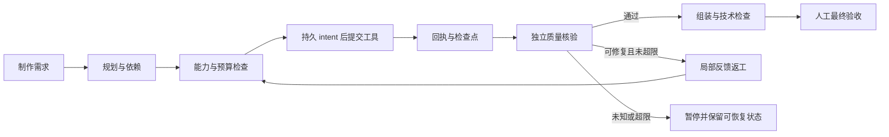

# LeonTV 架构

LeonTV 围绕 AI 视频创作组织执行能力，目标架构为 Agent Harness。当前创作以固定工作流为主，新增 Harness 测试运行基础已接入正式产品；以下区分实现范围与后续目标。

## 实现状态

| 层 | 当前实现 | 不应据此推导的能力 |
| --- | --- | --- |
| 应用执行层 | 六阶段状态机、阶段 Agent、画布与任务 API、模型客户端、FFmpeg | 动态任务分解、自由多 Agent 协商 |
| 产品运行基础 | Studio 运行验证、正式 Harness API、私有持久状态、幂等键、版本/质量门禁、恢复与测试终审 | 真实模型规划、真实作品质量或生产验收；本切片仅 test/fixture |
| 独立实验层 | 确定性 Harness PoC；受控真实 API 试制及预算/回执保护 | 正式产品入口已经具备自动规划、独立审查、自动修复 |
| 目标创作闭环 | 真实 Planner、受限工具循环、独立 Reviewer 与局部返工待接入运行基础 | 已交付完整自主创作、标准 A2A、长期记忆或 Personal Agent |

## 现役创作链路

前端使用 Next.js、React、TypeScript、Tailwind CSS 与 React Flow。FastAPI 后端负责会话、项目、阶段执行、生成任务与媒体访问。

`backend/core/orchestrator.py` 中的 `WorkflowEngine` 按 `STAGE_ORDER` 调度六个阶段。状态保存在 `WorkflowState`，阶段结果写入共享的 `artifacts` 与元数据，并持久化到本地。

| 阶段 | 处理器 | 职责 |
| --- | --- | --- |
| 剧本 | `ScriptWriterAgent` | 将输入整理成结构化剧本与场次 |
| 角色与场景 | `CharacterDesignerAgent` | 角色、场景设计与相关素材 |
| 分镜 | `StoryboardAgent` | 镜头规划、结构校验与连续性约束 |
| 参考图 | `ReferenceGeneratorAgent` | 为后续视频生成准备画面参考 |
| 视频 | `VideoDirectorAgent` | 调用选定视频模型生成片段 |
| 后期 | `VideoEditorAgent` | 通过 FFmpeg 合成选定片段 |

这些 Agent 是由一个编排器调用的阶段处理器。角色与参考图阶段已有局部“生成—VLM评估—反馈—有限重生”路径，分镜也有结构校验与修正逻辑；它们还没有组成独立、通用的跨阶段 Reviewer。

当前视频生成策略包括首帧、首尾帧和角色/场景参考，具体可用组合受所选模型、服务商和适配器能力约束。后期为媒体合成流程，尚未提供专业多轨时间线编辑器。

## 产品入口

路径均相对 `Leon TV/Leon TV/backend/`：

| 接口模块 | 用途 |
| --- | --- |
| `api/routers/workflow.py` | 工作流阶段执行、进度与确认 |
| `api/routers/studio.py` | 画布项目与节点数据 |
| `api/routers/sandbox.py` | 单次图像/视频生成与异步任务 |
| `api/routers/pipelines.py` | 专项短流程任务 |
| `api/routers/configuration.py` | 本地模型与服务商配置 |
| `api/routers/harness.py` | 零付费测试运行、查回、事件、受控媒体、动作与测试终审 |

自由画布由用户连接并运行节点。节点与连线形成创作关系，前端负责展示运行状态和结果；完整 DAG 的自动调度与自主规划尚未实现。

## 模型与工具

`backend/models/` 将 LLM、VLM、图像与视频服务商隔离在适配层；`config_model.py` 提供型号与能力目录。模型选项、适配器支持和实际服务商验证是不同的证据层，不能仅凭目录条目判定一个模式稳定可用。

`backend/media_tools.py` 优先使用系统 FFmpeg，缺失时尝试 `imageio-ffmpeg` 的二进制。模型生成、素材读取、结果下载和本地媒体处理分别保留其成功与失败状态。

外层 `Leon TV/SKILL.md` 和 `references/` 是给外部 Agent 的调用说明，不是产品内已实现的 Skill 发现、加载和沙箱权限系统。

## 产品内 Harness 运行基础

Studio 画布右上角的「运行验证 · 测试」连接 `/api/harness/runs`。`core/harness/` 使用真实文件存储与后台执行器，只有 Planner、供应商和 Reviewer 使用确定性测试实现。测试媒体为专用 TEST 合成片段，不引用旧付费样片。

客户端在创建前保存请求键和原参数；服务端对业务参数计算摘要，在同一原子事务内建立运行、键索引和项目关联。响应丢失可按原键查回，同键变参拒绝；读取与事件重放不会派发工具。画布来源在此切片只绑定摘要和稳定记录 ID，未验证剧本语义。

私有 `harness_data/product_runs/` 位于静态挂载之外。状态、单调事件序号、操作回执与额度一起落盘；跨进程文件锁限制同一运行的执行。快照和事件仅返回白名单字段。媒体按运行/产物 ID 与版本读取，并核对摘要，不接受任意路径。

测试计划是 `reference → shot → final`。执行成功与质量通过分开保存；审查绑定产物哈希、版本、依赖和规则。改版使受影响后代及旧判断失效，保留历史版本。最终测试决定在同一锁定事务内重新核验文件、依赖、审查与 manifest，不能仅凭相同成片哈希放行旧证据。

测试执行次数有全局上限。存在 `submitting/unknown` 操作时，停止不会抹除未决状态，不能通过改版或续跑绕过对账；对账只查询原操作。进程重建后查回检查点，读取不自动重提，显式恢复复用已完成产物。

界面与响应始终标记 `test/fixture`，模型和付费调用为零；质量通过、局部返工与最终决定只证明测试机制。真实生产的费用预占、供应商差异、内容 Reviewer、音画与人物质量仍须另行接入和验收。[接口合同](./HARNESS-RUNTIME-API.md) · [验证记录](./HARNESS-RUNTIME-VALIDATION.md)。

## Harness 实验

### 确定性本地 PoC

`backend/experiments/harness_poc/` 是可独立运行的实验，验证工具白名单、持久状态、有限修正、超时与恢复、产物校验和绑定版本的人工终审。Planner、Worker 和 Reviewer 使用确定性实现；该实验不调用真实 LLM，也不证明自主生成质量。使用说明见 [`HARNESS-POC.md`](../Leon%20TV/Leon%20TV/backend/docs/HARNESS-POC.md)。

### 受控真实 API 试制

`backend/experiments/tudou_ab/` 支持一请求一记录的真实试制，包含请求前预算预占、提交 intent、任务回执、受理不明时禁止重发、媒体交付绑定以及技术规格检查。

该执行器依赖本地私有授权与材料，公开代码不附带授权文件、原文、密钥、账本或签名媒体链接。它不是可直接启动的通用产品任务入口。公开的两条结果与验证范围见 [DEMO.md](./DEMO.md)。

预算保护使用已核对报价的保守预占；预占、实际扣款与未核清费用必须分别记录，不能把未结算金额当作零成本。

## 目标运行合同

在已接入的测试运行基础上，下一步连接真实模型和创作工具，形成以下闭环：

这是完整生产闭环的设计目标。测试运行已验证下列机制，接入真实供应商时仍须重新验证对应行为：

- 相同创建键重试可查回原运行，变更参数不能冒用同一键。
- 远端是否受理不明时先查回，不盲目重复付费提交。
- 运行与质量状态分开；工具返回成功不自动标记内容合格。
- 预算、超时和修复次数有明确上限，未知费用保留风险占用。
- 核验与人工决定绑定当前产物版本和哈希，旧版本决定不能放行新产物。
- 刷新、断线或重启可以恢复检查点；私有状态位于公开媒体挂载之外。

## 数据与部署边界

本地运行数据位于 `backend/code/data/`，生成媒体位于 `backend/code/result/`；Harness 产品运行与实验私有状态位于 `backend/harness_data/`。这些资料不提交到公共仓库。

默认部署是单用户本机 Web 应用。它保存本地项目，但远程模型会接收完成调用所需的提示词和素材。公共 SaaS 的身份认证、租户隔离、凭据托管、配额及运维不是当前已完成的部署能力。
