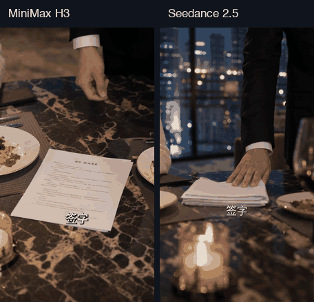

# 真实生成视频演示

两条视频使用同一场景、同一参考图和同一首次提示词，通过土豆 API 分别请求精确模型ID `minimax-h3` 与 `seedance-2.5`。本页展示产出，不附带私人剧本、原始请求或服务商签名链接。

## 观看

[](./assets/demos/seedance-2.5-15s.mp4)

| 型号 | 完整文件 | 文件SHA-256 |
| --- | --- | --- |
| MiniMax H3 | [15秒MP4](https://github.com/leo-ai-pm/LeonTV/blob/main/docs/assets/demos/minimax-h3-15s.mp4) | `bc9c0ce8f132f3f014df477b17d8f72f99f2d95740ce804458185b1a1703d9ba` |
| Seedance 2.5 | [15秒MP4](https://github.com/leo-ai-pm/LeonTV/blob/main/docs/assets/demos/seedance-2.5-15s.mp4) | `ea07ef4fc8145ab7895fa8398734781f810913569e007520239b5f7a8dd01c4e` |

动态GIF取自两条真实视频的2.0–4.5秒片段，只用于快速预览；完整视频各15秒，包含原生音轨。

## 如何得到这些文件

```text
已选定的场景 → 共用参考图 → 两个视频模型分别生成
                             ↓
                    保留原片与任务回执
                             ↓
             FFmpeg规范化 → 技术检查 → 人工视听验收
```

本轮由操作侧规划、提交和检查。后端使用受控试制执行器保存请求intent、预算预占、任务回执与媒体对应关系。真实生成证明服务链路能产出文件；完整的产品内自主规划、审查与返工仍需开发。

| 项目 | 两份公开文件 |
| --- | --- |
| 画风/画幅 | 写实影视、竖屏9:16 |
| 分辨率 | 720×1280，方形像素 |
| 帧数/帧率 | 360帧，24fps |
| 视频/容器时长 | 15.0秒 |
| 编码 | H.264视频、AAC音频 |
| 文件技术检查 | 全片解码通过 |
| 后处理 | 小幅同步变速、必要缩放裁切、规格规范化 |

AAC解码存在编码尾帧填充；技术规格通过不等于对白和音画同步通过。发布MP4与本地首次审阅导出字节一致，没有为公开展示另行替换生成内容。哈希和采样参数见 [manifest.json](./assets/demos/manifest.json)。

## 当前发现

- 两片仍有模型自行生成的字幕，未满足该项创作约束。
- H3存在人物微笑、抚腹的动作偏差；一次定向返工未解决，首次样本保留用于同条件比较。
- Seedance采样中人物情绪更符合本轮设定，未在这些采样中看到同类动作；采样不足以证明全片所有约束均通过。
- 三句对白的说话者、先后顺序、口型与音画同步仍待完整人工听验。

每模型只有一个同条件主样本，不能由此给出总体优胜、稳定性或成功率结论。两条视频是可行性验证样片，内容质量尚未验收通过。

## 文件复核

从仓库根目录执行：

```bash
shasum -a 256 docs/assets/demos/minimax-h3-15s.mp4
shasum -a 256 docs/assets/demos/seedance-2.5-15s.mp4
```

文件的来源、公开副本摘要、尺寸与动态预览处理参数记录在公开manifest中；私人剧本、凭据、供应商响应、账本和签名媒体链接不在公共仓库中。
