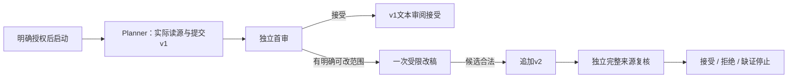

# 四角色受控文本执行 · D25

本切片把 Planner、Reviewer、Repairer、Rechecker 接到原有 `ExecutionRuntime`、执行锁、报价、授权、累计账本与 HTTP 回执通道。角色模型返回通过合成传输验收；真实供应商执行仍受原正式计费门禁限制，默认关闭。它不授权图片、视频或音频生成。

沿用 [D09 执行接口](./PLANNER-EXECUTION-API.md)；D08、D23、D24 离线任务不能升级为付费任务。原经验试跑记录也不会被导入成正式授权或已确认账单。[本轮验收记录](./PLANNER-ROLE-EXECUTION-VALIDATION.md)。

## 授权与兼容

服务端显式设置 `ExecutionPolicy.role_workflow="bounded_revision_v1"` 才启用四角色；未显式设置时保持旧 Planner 策略和历史摘要。客户端不能选择或提交角色、模型、价格、上限或执行上下文。

首次报价冻结执行任务的 workflow 和环境。已有旧执行记录不能通过新报价增加角色权限；新流程也不能静默降回旧流程。正式任务仍按“核对报价 → 明确授权 → 单独开始”启动，授权本身不发送模型请求。

新报价额外披露 `role_workflow` 和 `role_scope`，其内容被纳入原 `disclosure_hash`。披露列出四个角色、完整冻结来源、v1计划、首审报告、改稿任务、v2候选、旧问题定位，以及总调用和角色上限。新授权保存 `role_workflow`、`role_scope_hash`，绑定所确认报价；旧授权不获得这些权限。

四个角色共用原任务与账户余额：总意图最多6次，Reviewer、Repairer、Rechecker各最多1次。协议纠错也消耗总次数，不为改稿另开预算。换授权、角色或重启均不清除已用次数、本地计价和未知预占。

## 执行与结果

首审已接受就结束v1，不制造返工。只有真实有效的拒绝报告和允许字段提案才能委派改稿。无变化、越权修改、错误来源／操作／版本绑定或非法输出均停止；复核再次拒绝、缺证或非法也停止，不生成v3。

独立角色上下文直接复用 [D18 首审与修订合同](./PLANNER-REVIEW-API.md)、[D24 复核合同](./PLANNER-REVISION-CYCLE-API.md)。Reviewer、Rechecker使用新的完整来源上下文，不继承生成者聊天、推理或自评；Repairer仅获得明确编辑范围。各角色不能调用媒体或任意文件工具。

每次请求沿用同一个提交点：核对策略、授权、期限、可信输入上界及累计余额，原子保存预占、意图和许可，再执行一次HTTP。新操作及许可同时绑定 `role_workflow,role,role_call_index,role_binding_hash`；实际请求重新核对这些标签和原 context／wire。

完整回执先持久化，再按原冻结费率本地计价，随后处理角色内容。**计费回执有效但角色内容非法，仍计价并停止**，不会把无效创作输出当成免费请求。缺失、超界或未知回执保留预占；已有回执恢复只处理原结果，没有确认回执不自动重发。

暂停和撤销阻止后续委派，在途结果可以保存；它们不声称取消供应商任务或退款。新profile的历史操作身份、角色绑定、上下文、许可、首次回执及已结算金额不可改写；读取和写入都检查历史约束。

## 安全投影

沿用原 `ExecutionDetail`、最新有效 `plan`、累计 `ledger` 和操作列表。只有新profile追加以下字段；旧响应不回填。

| 位置 | 新字段 |
| --- | --- |
| Policy | `role_workflow` |
| Quote | `role_workflow,role_scope` |
| Grant | `role_workflow,role_scope_hash` |
| OperationSummary | `role_workflow,role,role_call_index,role_binding_hash` |
| ExecutionDetail | `role_workflow,role_state`；`environment`取该新任务冻结值 |

`role_state`只返回流程状态、四角色累计次数／上限、首审／改稿／复核绑定和摘要、首审／复核 verdict、接受版本，以及 `plans[{version,plan_hash}]`。不返回完整报告、上下文、原始模型响应或推理。新状态含 `awaiting_plan`、各角色 ready／running／response_unknown，以及 accepted／rejected／unknown／needs_input／invalid 终态。

`quality_status`仍是 `not_reviewed`；角色 verdict只说明对应版本的一次文本判断。合成 accepted不代表真实判断，真实文字判断也不替代媒体质量与人工终验。`provider_bill_confirmed`仍为false，本地计价不是实际供应商账单。

前端按执行记录的环境展示历史，不用当前策略把已有真实记录标成合成零费用。新profile展示共享账本、角色进度、计划版本和逐操作回执，不增加角色之间的人工按钮。

## 真实执行边界

正式开关、APIKey、冻结策略、可核实费率与可信输入上界仍由服务端控制，本轮不更改生产bootstrap。此前土豆Gemini实测未建立可靠输出硬上限，不能把实验风险预留冒充正式计费上界。

后续需要把明确披露的经验风险模式接入同一授权、累计账本和回执链路，再进行新的小额真实协作验收；无需把客服回复作为实测前提。原100元预算、既有风险和未知记录继续保留，旧范围不能重置或重复调用。视频通道故障另行恢复，不由本切片宣称解决。
