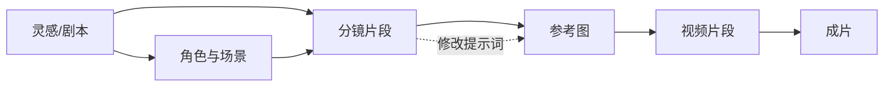

# LeonTV 桌面创作平台 PRD v0.1（LibTV 对标）

> 状态：第一版产品基线，开发分阶段进行｜日期：2026-09-30｜范围：**仅桌面 Web，不做手机端**  
> 现状基线：当前工作区 `xiaoyunque-main/xiaoyunque/xiaoyunque`，已由产品方确认是最新版。  
> 对标对象：用户提供的 [LibTV 官网](https://www.liblib.tv/)（`liblib.tv`）。本文件保留原始需求判断；实际交付状态见 [LeonTV 开发路线图](./DEVELOPMENT-ROADMAP-LeonTV.md)。

## 1. 产品判断

小云雀已经具备“从创意到成片”的六阶段生成内核：剧本、角色/场景、分镜、参考图、视频、后期，并有阶段确认、素材多版本、单项重生成、模型切换和本地成片下载。当前产品的主要形态仍是**线性流程页 + 独立工具页**。LibTV 公开展示的产品形态是**项目工作区 + 无限画布 + 多工具入口 + 资产复用 + Agent/剪辑能力**。[官网首页](https://www.liblib.tv/)与[产品介绍页](https://www.liblib.tv/wappro?sourceid=040004)均以画布创作为核心入口。

因此第一阶段的目标，是让创作者在一个桌面项目里看见素材之间的关系、自由排布和局部迭代，并复用现有六阶段内核。画布不能只是一张流程图：节点的输入、输出、状态、版本和重新生成必须能实际工作。与此同时，原有“一键生成 / 逐步创作”应继续作为上手入口。

### 目标用户与核心场景

| 用户 | 要完成的事 | 当前阻碍 |
| --- | --- | --- |
| 独立短片/短剧创作者 | 从创意形成剧本、分镜、镜头素材并导出成片 | 在多个阶段和工具页之间切换，难以总览与复用 |
| 广告/内容团队创作者 | 同一创意尝试多条视觉方案、比较版本、只改一个片段 | 资产分散在会话内，分支与依赖关系不直观 |
| 高级 AI 创作者 | 组合文生图、图生图、视频生成和现有 Agent | 独立工具运行结果难以成为项目内下一步输入 |

### 成功标准（V1 验收后观测）

- 新用户在不看说明的情况下，能在桌面端创建项目、从灵感自动生成或空白画布开始、完成一条“剧本片段 → 参考图 → 视频片段 → 导出”的路径。
- 已有项目能打开为画布，原有剧本、角色/场景、分镜、图片和视频不丢失；返回原流程页仍可查看项目。
- 改动单个分镜/参考图/视频片段时，界面明确标记受影响的下游节点，并允许只重做该局部，不强制重跑整片。
- 无模型密钥时，画布编辑、项目保存、素材查看和演示样例可正常使用；真正发起生成时给出配置入口和可理解的错误。

## 2. 对比依据与现状

现状依据：已检查 [前端页面与工作流代码](../xiaoyunque/xiaoyunque/frontend/components/WorkflowPanel.tsx)、[临时工作台](../xiaoyunque/xiaoyunque/frontend/components/Sandbox/Sandbox.tsx)、[后端工作流 API](../xiaoyunque/xiaoyunque/backend/api/routers/workflow.py)及[会话数据结构](../xiaoyunque/xiaoyunque/backend/docs/session_format.md)，并打开当前运行中的桌面前端。2026-09-30 本机前端 `127.0.0.1:3002/` 与后端 `/api/health` 均返回 200。当前 `config.yaml` 未配置生成所需的模型密钥，本次未验证完整 AI 出片。

对标依据：直接查看 [LibTV 首页](https://www.liblib.tv/)、[项目页](https://www.liblib.tv/project)、[产品介绍页](https://www.liblib.tv/wappro?sourceid=040004)、[官方版本更新记录](https://www.liblib.tv/feature-updates)（2026-09-20 的 v1.5 与 2026-09-11 的 v1.0）。点击“新建项目”触发登录弹窗，因此**登录后的画布细节、权限和真实操作性能未核验**。下面标注“建议”的交互、优先级和验收值，是我们的方案，不是对 LibTV 内部实现的断言。

| 能力域 | LibTV 公开可见/官方说明 | 当前小云雀 | 差距判断 |
| --- | --- | --- | --- |
| 创作入口 | 首页“新建画布创作”；视频/图片/音频/剧本/智能剪辑入口 | 创作首页、临时工作台、三条专项流水线 | 缺统一的项目级创作空间 |
| 无限画布 | 官方介绍写明“无限画布、自由编排”；更新记录提到画布节点、性能优化 | 六阶段固定顶栏和阶段页；无可拖拽节点/连线/画布数据 | **核心新增** |
| 生成与模型 | 官网展示多模型入口和多种创作工具 | 已有 LLM/VLM/文生图/图生图/视频、模型注册与配置 | 需要节点级配置、输入引用及结果回流 |
| 项目管理 | 项目页可见搜索、文件夹、回收站 | 首页会话历史，支持恢复/删除 | 需要项目工作区、组织与安全删除 |
| 资产管理 | 首页独立“资产”入口；官方介绍强调资产/工作流沉淀 | 角色、场景、参考图、片段按会话保存，单项有版本 | 缺跨项目素材库、引用关系和检索 |
| 剧本创作 | 更新记录展示原创、局部改写 | 已有剧本生成、选择及部分编辑/续写 | 需要片段级改写和变更影响提示 |
| 角色一致性 | 更新记录展示角色造型室和复用角色资产 | 有角色/场景图及版本选择 | 缺全局角色档案和跨项目复用 |
| 分镜与镜头 | 更新记录展示导演执导、拆镜、宫格切分 | 有 `episode → segment → shot` 结构，按 segment 生成图片/视频 | 缺可视分镜编排、分支比较；V1 仍按 segment 执行 |
| 音频 | 首页有音频生成入口 | 专项流水线已有 TTS 配音和音频产物预览 | 缺项目画布里的独立音频节点与音频轨 |
| 视频精修/剪辑 | 更新记录展示智能剪辑、续写、片段重拍、逐帧拉片 | 已有片段重生成与按剧集拼接导出 | 缺可调整顺序/裁切的时间线和局部精修 |
| Agent/模板/社区 | 首页有 Agent、TV Show；介绍页写明工作流分享 | 六阶段 Agent 自动/手动流程；专项流水线有部分模板 | 缺画布模板、可复用工作流和作品分享 |
| 3D/插件/计费 | 首页有 3D-BOX、插件与扩展、会员积分 | 当前未见对应模块；采用本地配置模型密钥 | 后续方向，非首版必要条件 |

## 3. 版本边界与新增模块

**V1 = 桌面可用的项目画布闭环。** 优先跑通“创建项目 → 组织和生成素材 → 局部修改 → 预览/导出”。P1/P2 是后续候选，不属于 V1 验收。优先级是本 PRD 的产品建议。

| 编号 | 模块 | 优先级 | V1 要求 / 后续边界 |
| --- | --- | --- | --- |
| M01 | 项目中心与工作区 | P0 | 新建/搜索/重命名/复制/删除与恢复项目；入口区分“从灵感自动生成”“空白画布”“已有项目”，提供无密钥演示样例 |
| M02 | 无限画布底座 | P0 | 平移、缩放、适配视图、节点拖放、多选、连线、撤销/重做、自动保存、缩略导航；桌面键鼠操作 |
| M03 | 画布节点与数据模型 | P0 | 支持文本/剧本、角色/场景、分镜片段、参考图、视频片段、成片节点；保留输入、输出、版本和来源 |
| M04 | 节点执行与依赖 | P0 | 类型合法的连线、运行状态、错误重试、局部重生成、下游失效提示；复用现有工作流和工具 API |
| M05 | 项目资产库 | P0 | 上传/收集图片和视频，按类型/项目检索，查看版本，拖入画布并复用；被引用素材的删除保护 |
| M06 | 分镜可视编排 | P0 | 以集和片段组织分镜卡片；编辑提示词、时长与镜头描述；从片段生成参考图和视频 |
| M07 | 生成参数面板 | P0 | 节点级模型、比例、时长、提示词与参考素材配置；展示密钥缺失、生成进度和失败原因 |
| M08 | 预览与成片导出 | P0 | 片段预览、按顺序组成成片、导出本地文件；过期片段在导出前警示 |
| M09 | 旧项目接入 | P0 | 已有六阶段会话映射到新画布；旧资产/版本/选择保留；不重复生成或迁移丢失 |
| M10 | 剧本局部改写 | P1 | 按段落/场景改写与版本对比，关联分镜标记需更新 |
| M11 | 角色/场景档案 | P1 | 可复用角色设定、参考图、造型版本与跨镜头引用 |
| M12 | 多轨时间线与智能剪辑 | P1 | 片段排序、裁切、字幕/配音/音乐轨；自动粗剪作为独立可选能力 |
| M13 | 画布模板与工作流复用 | P1 | 保存个人模板；从模板新建项目；导入/导出画布结构（不自动公开素材） |
| M14 | 导演 Agent 与批量操作 | P1 | 在画布上建议下一步、生成一组分镜/提示词，并在执行前展示影响范围 |
| M15 | 社区/作品展示 | P2 | 公开作品、创作过程、画布模板与收藏；需先有权限和分享规则 |
| M16 | 高级视频工具 | P2 | 逐帧拉片、任意位置续写、片段重拍、动作捕捉、3D 预演 |
| M17 | 插件/团队/计费 | P2 | 外部插件、协作权限、云端算力和积分体系；按商业模式再定 |

## 4. V1 核心流程与交互

### 4.1 信息架构（桌面）

左侧主导航：**项目、资产、临时工具、设置**。项目内为：**顶部项目栏 + 左侧节点/素材面板 + 中央无限画布 + 右侧节点属性/版本面板 + 底部任务状态**。原有逐步流程可以作为项目内“阶段视图”保留；两种视图读取同一项目产物，不能各自维护一套互相冲突的数据。

图表示**产品数据关系**，不是要求 V1 实现任意可编程 DAG。V1 只允许已定义输入/输出类型的连线；图像和视频的生成粒度继续沿用当前 `segment_id`，一个分镜片段中的多个 `shot` 先作为片段内部信息展示。任意循环、任意脚本节点和跨用户协作不在 V1。

### 4.2 三条必须跑通的用户路径

1. **从创意开始**：创建项目 → 填写想法 → 选择逐步/自动生成 → 生成结果落到画布 → 打开任意节点查看来源、参数、版本 → 继续到导出。
2. **从空白画布开始**：添加文本/图片/视频节点 → 用合法连线传入提示词/参考图 → 选择模型运行单节点 → 输出作为新资产留在项目中 → 选中版本继续生成。
3. **修改局部**：选择一个分镜片段 → 修改视觉或视频提示词 → 下游参考图/视频标记“待更新” → 只重生成选中片段 → 保留旧版本供比较 → 预览并导出最新选中版本。

### 4.3 关键规则与验收口径

| ID | 需求与规则 | 验收口径 |
| --- | --- | --- |
| R01 | 画布操作 | 在 1366×768 及以上桌面视口可新建、移动、缩放、框选、连线节点；刷新后位置和连线恢复。空格拖动/触控板平移、滚轮缩放、适配视图有明确入口。 |
| R02 | 编辑可靠性 | 节点文本、坐标、连线及选中版本自动保存；显示“保存中/已保存/失败”；失败可重试。撤销/重做至少覆盖最近 20 次画布结构编辑。 |
| R03 | 连线约束 | 不兼容类型、重复连接和形成循环时阻止并说明原因；已存在输入被替换时说明影响；删除节点前提示下游引用。 |
| R04 | 节点运行 | 节点显示未运行/排队/运行中/成功/失败/待更新；可查看输入快照、模型、提示词、产物、错误和运行时间；失败只重试该节点或明确列出的依赖。 |
| R05 | 局部变更 | 修改上游后，直接/间接下游标记“待更新”，旧产物保留且可预览；用户明确选择更新范围后运行，系统不静默覆盖已选版本。 |
| R06 | 资产复用 | 上传或生成的文件进入项目资产库；可拖入当前画布，也可从其他项目“引用”；一份资产被多个节点引用时不重复拷贝；删除被引用资产需给出引用清单。 |
| R07 | 旧项目兼容 | 随机抽取至少 3 份不同阶段的旧会话，打开后剧本/分镜/图像/视频、`segment_id` 对应关系及所选版本与原流程一致；刷新和后端重启后仍一致。 |
| R08 | 生成配置 | 未配置对应模型密钥时，运行按钮给出明确配置入口；配置后按节点参数调用；运行结果自动归档为新版本，保留失败记录。 |
| R09 | 导出 | 选择片段顺序和版本后生成成片；缺片段或引用过期时阻止/警示；导出文件可在本地播放，项目里能再次找到。 |
| R10 | 安全删除 | 项目删除先进入回收站，可恢复；永久删除须二次确认。导入旧项目时不修改原始会话文件，直到用户确认保存。 |

## 5. 数据与技术边界（需求层）

V1 的核心对象建议为 `Project`、`Canvas`、`Node`、`Edge`、`Asset`、`AssetVersion`、`Run`。节点存储稳定 ID、类型、坐标、参数、输入引用、输出资产版本、状态与源会话/源 `segment_id`；连线存储源/目标节点与端口；运行记录存储输入快照和错误。旧六阶段 `session` 是现有业务资产，不能仅凭页面渲染临时节点，否则无法持久编辑和局部重跑。

现有后端是**顺序阶段编排器**，并非通用节点调度器。M04 的“任意节点局部执行”需要新增画布执行层或适配层，明确哪些操作调用现有 `/api/project/...`，哪些调用 `/api/sandbox/...`，以及变更后哪些下游状态失效。产品验收关注行为一致性；具体库与存储方案留到任务阶段确定。

非功能要求：桌面 Chrome/Edge 最近两个稳定版；项目与资产仅在当前本地部署范围内，V1 不设多用户共享；200 个普通节点的项目应可打开和操作，目标首屏可操作时间 ≤3 秒（在双方约定的测试机器与样例数据上测量）；画布保存失败不得丢失用户正在编辑的文本；生成任务可停止且重开页面后仍能查到运行/失败结果。API 密钥沿用现有设置方式，不写进画布文件或导出包。

## 6. 明确不做与待确认

**V1 不做**：手机端、完整多轨剪辑器、社区发布、团队协作、积分/会员系统、3D-BOX、Blender 插件、逐帧拉片、任意时间点视频重拍，以及“无限节点规模”承诺。原有手机适配不是本 PRD 的交付目标。

进入任务阶段前需由产品方确认的决策：

1. V1 主要面向哪一类内容：短剧/漫剧、商业广告，还是通用短视频？这会影响默认模板、分镜字段和预览比例。
2. 空白画布里允许的首批节点，是否以本 PRD 的“文本/图像/视频 + 六阶段产物”为准？音频节点是否提到 P0？
3. 项目资产跨项目引用是只读引用，还是允许复制后独立编辑？本稿建议默认只读引用，编辑前显式“另存为”。
4. V1 是否保持本地单人/BYOK 模式？本稿按此假设编写，云端账号与计费留在 P2。

## 7. 参考资料与证据限制

- [LibTV 首页](https://www.liblib.tv/)：导航、画布与生成入口、Agent/3D、社区展示。
- [LibTV 项目页](https://www.liblib.tv/project)：搜索项目、新建文件夹、回收站；未登录状态下可见空项目页。
- [LibTV 产品介绍](https://www.liblib.tv/wappro?sourceid=040004)：剧本/角色/世界观、无限画布、自由编排、Agent、工作流分享。
- [LibTV 官方版本更新记录](https://www.liblib.tv/feature-updates)：v1.5 的剧本改写、导演执导、角色造型、画布优化；v1.0 的智能剪辑、续写、片段重拍、逐帧拉片等。
- [小云雀 README](../README.md)、[会话格式](../xiaoyunque/xiaoyunque/backend/docs/session_format.md)、[工作流 API](../xiaoyunque/xiaoyunque/backend/docs/api.md)：当前功能与实现边界。

官网登录后的画布操作、项目权限和资产逻辑未直接验证；涉及这部分的具体交互均按“建议方案”处理，不能视为 LibTV 事实复刻。所有官方功能描述以 2026-09-30 可见页面为准。
